# CleanSpeed — Speedtest without the bloat

Tests the internet speed of Wi-Fi, mobile data and Ethernet **without ads, trackers, accounts or bloatware**. One HTML file, runs in any modern browser, installs to the home screen like an app.

**▶ Run it: https://jsankr.github.io/Speedtest/**

<p>
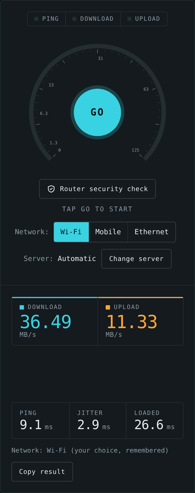
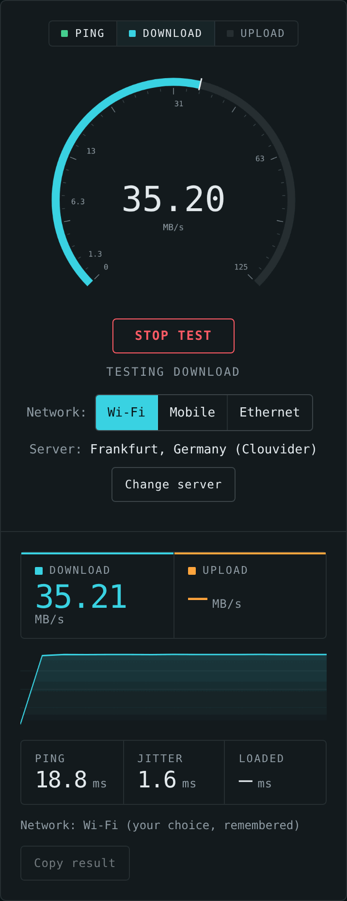
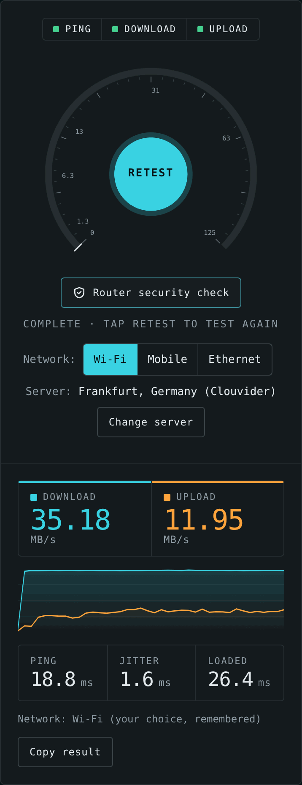
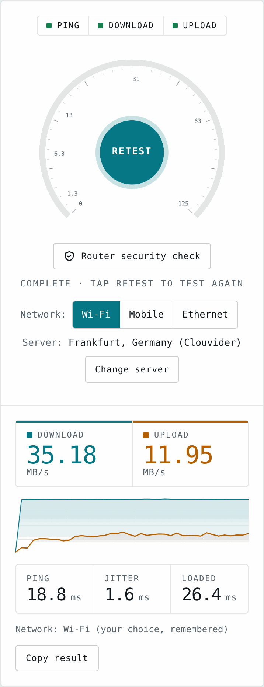
</p>

> **About the screenshots.** Every screen below uses **sample data**. They were captured in headless Chrome at iPhone width (390 pt, 2×) against a local stand-in server paced to about 35 MB/s down and 12 MB/s up, with simulated responses for the vulnerability database, IP lookup and DNS services. MAC addresses in the device-lookup screen are randomly generated (makers' registered prefixes with random device bytes, plus a random private address), so they don't belong to any real device. IP addresses come from the reserved documentation ranges (203.0.113.0/24, 2001:db8::/32). The router report uses a **fictional** router — brand *ExampleNet*, model *XR-1000*, hardware V2, firmware 2.1.0_1043 — with five made-up vulnerability records (`CVE-2099-0101` to `-0105`, advisory links on the reserved `.example` domain) so every status appears. Speeds, history, locations and IP details are invented too. Nothing here describes a real person's connection, router or devices.

---

## Contents

1. [What it does](#what-it-does)
2. [Screens](#screens)
   - [Speed test](#1-speed-test) · [Live network map](#2-live-network-map--telemetry) · [Insights](#3-result-insights) · [Global comparison](#4-global-comparison) · [Servers](#5-test-servers) · [History](#6-history--csv-export)
   - [Router security check](#7-router-security-check) · [Toolkit](#8-network-toolkit) · [Settings](#9-settings--units)
3. [How the measurement works](#how-the-measurement-works)
4. [Router check: how vulnerabilities are matched](#router-check-how-vulnerabilities-are-matched)
5. [Privacy: what leaves your device](#privacy-what-leaves-your-device)
6. [Install, use and self-host](#install-use-and-self-host)
7. [Troubleshooting](#troubleshooting)
8. [Limitations](#limitations)
9. [Architecture](#architecture) · [Design system](#design-system)
10. [Data sources and licences](#data-sources-and-licences)
11. [Changelog](#changelog)

---

## What it does

| Area | Features |
|---|---|
| **Speed test** | Download, upload, idle ping, jitter and **loaded ping** (latency while the line is busy). Live gauge and throughput chart. Stop at any time; **RETEST** after a run. |
| **Units** | Bytes or bits per second: KB/s, MB/s, GB/s, Kbps, Mbps, Gbps. Decimal (1000) or binary (1024, shown as MiB/s, Mibps). |
| **Servers** | Automatic (lowest ping), Cloudflare (anycast), Measurement Lab (ndt7), 22 LibreSpeed volunteer servers worldwide, or your own server. "Measure ping to all" compares them. |
| **Live map** | Route from you to the test server with animated data flow, live download/upload/ping tiles and a telemetry timeline. |
| **Insights** | Responsiveness grade (A+ to F) from loaded ping, what the connection can handle (streaming, calls, gaming, backups), your place among 100+ countries. |
| **Global comparison** | Your result against the world and national medians (Ookla Speedtest Global Index), for broadband or mobile. |
| **History** | Every test saved on your device, trend chart, filter by network, editable network label, CSV export. |
| **Router security** | Scores your router settings, looks up known vulnerabilities for your exact model and firmware in the U.S. National Vulnerability Database (NVD), and gives step-by-step fixes — **manufacturer-approved fixes only**. |
| **Toolkit** | Ping & outage monitor, DNS benchmark, My IP & ISP, data/time calculator, Wi-Fi password generator & strength check, device (MAC) lookup, subnet calculator, global compare. |
| **App** | Single HTML file, "instrument panel" design (see [DESIGN.md](DESIGN.md)), dark and light themes, reduced-motion support, installable, no build step, no third-party scripts, no analytics. |

---

## Screens

### 1. Speed test

| Ready | Testing | Done |
|:--:|:--:|:--:|
|  |  |  |
| Tap **GO**. The tiles show the most recent saved result. | The gauge and chart update live. **Stop test** cancels instantly. | **RETEST** replaces GO. The chart overlays download (cyan) and upload (amber). |

- **Steps** at the top light up in order: Ping → Download → Upload.
- **Network** — pick Wi-Fi, Mobile or Ethernet. Browsers on iPhone don't reveal the connection type, so CleanSpeed asks once and remembers. Where the browser does report it (some Android/desktop Chrome builds), it's detected automatically.
- **Router security check** sits directly under GO (see [section 7](#7-router-security-check)).
- **Copy result** copies a one-line summary, e.g. `Download 35.19 MB/s · Upload 12.44 MB/s · Ping … · Server Frankfurt, Germany (Clouvider)` (sample).
- **Ping / Jitter / Loaded**: idle round-trip time, its variation, and round-trip time while the download is running.

### 2. Live network map & telemetry

| During download | During upload |
|:--:|:--:|
| 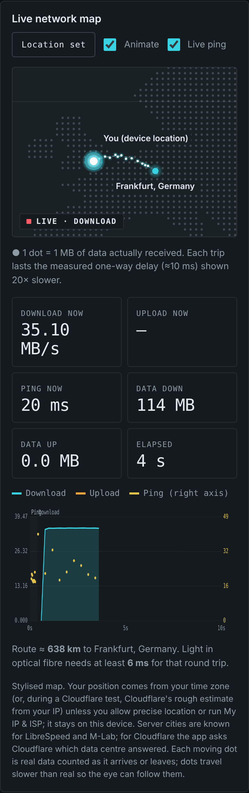 | 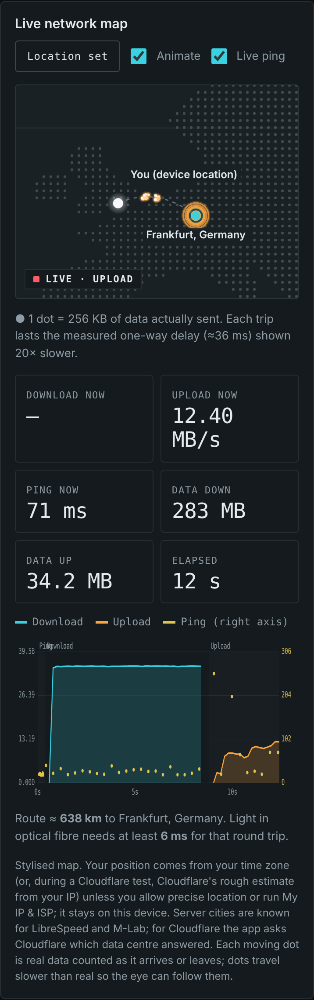 |

- **Map** — a stylised dot-matrix world, zoomed to fit the route. Every moving dot is **real data**: a dot leaves only when that much data has actually been received (download, **server → you**, cyan) or sent (upload, **you → server**, amber), counted from the same byte counters as the result. The legend under the map says how much each dot stands for (16 KB to 256 MB, so there are never more than about 50 a second).
- **Timing** — each dot's trip lasts the measured one-way delay (ping ÷ 2) shown **20× slower**, so the eye can follow it; a ring flashes when it lands. Pings (green) go out and come back over their measured round-trip time.
- **Live ping** — after a test, while the map is on screen and the page is in front, the app pings the last server every 2 seconds and animates each one. Untick **Live ping** to stop; the setting is remembered.
- **Cloudflare** — the app asks Cloudflare which data centre answered (its `/meta` and `/cdn-cgi/trace` endpoints) and draws the route to that city. If you and that data centre are in the same area, the server is drawn a short way off and labelled *near you*.
- **Your position** comes from your time zone by default, or from Cloudflare's rough estimate based on your IP during a Cloudflare test (used for the drawing only, never stored). Tap **Use precise location** for GPS (rounded to ~1 km and kept on your device), or run **My IP & ISP** to use the IP-based city.
- **Live tiles** — download now, upload now, ping now, data down, data up, elapsed.
- **Timeline** — download and upload on the left axis, ping (orange dots) on the right axis, with phase bands.
- **Route facts** — straight-line distance and the physical minimum round trip (light in fibre ≈ 200 km per ms). If your ping is *lower* than that minimum, you weren't really connected to that city (often a VPN or iCloud Private Relay).

### 3. Result insights

| Dark | Light |
|:--:|:--:|
| 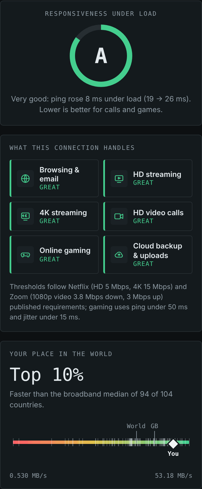 | 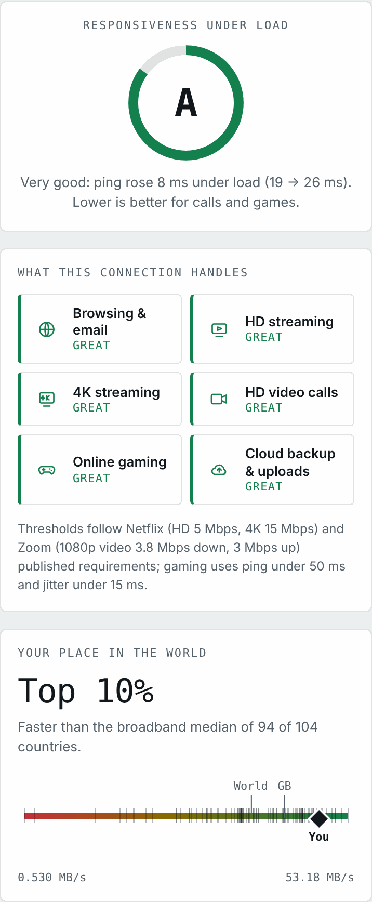 |

**Responsiveness under load** grades how much ping rises while the line is busy (bufferbloat):

| Rise in ping under load | Grade |
|---|---|
| under 5 ms | A+ Excellent |
| 5–29 ms | A Very good |
| 30–59 ms | B Good |
| 60–199 ms | C Fair |
| 200–399 ms | D Poor |
| 400 ms or more | F Very poor |

**What this connection handles** uses published requirements: Netflix HD 5 Mbps and 4K 15 Mbps; Zoom 1080p video 3.8 Mbps down / 3 Mbps up; gaming needs ping under 50 ms and jitter under 15 ms.

**Your place in the world** places the download on a ruler of national broadband (or mobile) medians, with markers for the world and your country.

### 4. Global comparison

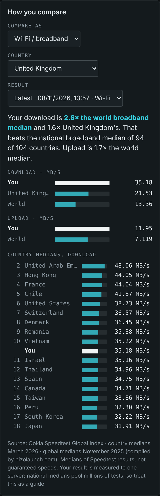

- **Compare as** Wi-Fi / broadband or mobile.
- **Country** defaults to the one matching your time zone; change it freely.
- **Result** picks any saved test, not just the latest.
- Bars compare you with your country and the world median for download and upload, followed by the full country ranking with your position inserted.
- Source line under the chart: Ookla Speedtest Global Index country medians (March 2026) and global medians (November 2025), compiled by bizolaunch.com. These are medians of many users' tests, not guaranteed speeds — treat the comparison as a guide.

<br clear="right">

### 5. Test servers

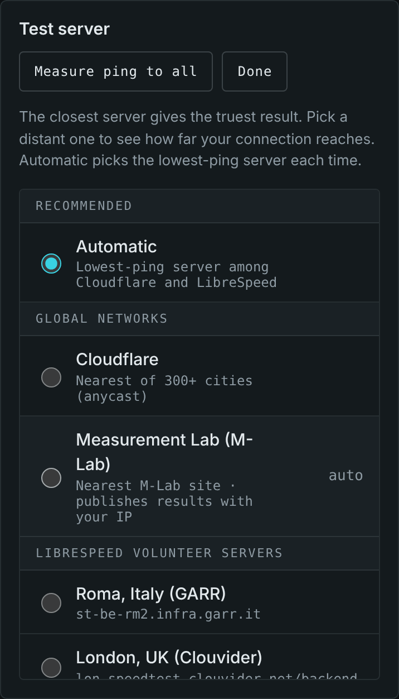

Open with **Change server**.

| Server | What it is | Notes |
|---|---|---|
| **Automatic** | Lowest ping among Cloudflare and LibreSpeed | Default |
| **Cloudflare** | `speed.cloudflare.com`, anycast to the nearest of 300+ cities | The app asks Cloudflare which data centre answered, so the map shows the real route |
| **Measurement Lab** | Nearest M-Lab site via the ndt7 protocol | **Asks before use**: M-Lab publishes test results, including your IP address, as open data |
| **LibreSpeed** | 22 volunteer servers (Europe, Americas, Asia, Oceania) | List refreshed from librespeed.org when reachable; a built-in snapshot otherwise |
| **Your own server** | Any URL running `server/server.py` | See [Self-host a test server](#self-host-a-test-server) |

**Measure ping to all** pings every server so you can pick the closest. A distant server shows how your connection copes with long routes.

<br clear="right">

### 6. History & CSV export

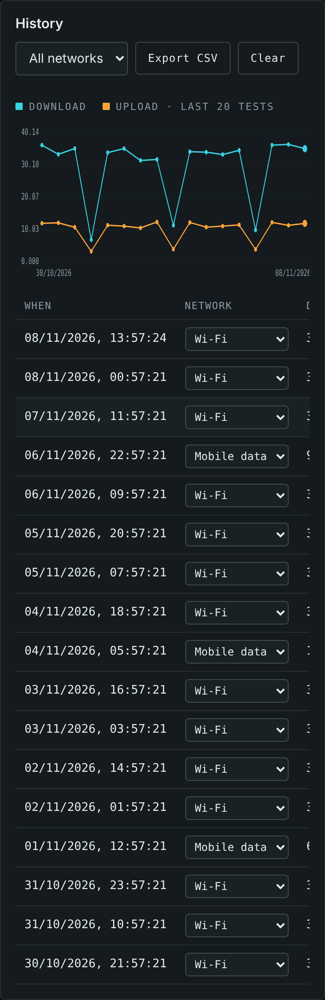

- Up to **300 tests** stored in your browser (`localStorage`) — never uploaded.
- **Trend chart** of the last 20 tests. The sample history is invented: Wi-Fi tests around 31–37 MB/s with a few mobile-data tests in between.
- **Filter** by network; **change the network** of any past test from its drop-down.
- **Export CSV** opens the share sheet on phones (Save to Files, Mail…) and downloads a file elsewhere. UTF-8 with BOM so Excel opens it correctly. Columns:

```
timestamp,network,download_Bps,upload_Bps,download_Mbps,upload_Mbps,ping_ms,jitter_ms,loaded_ping_ms,server
```

- **Clear** deletes the history from this device.

<br clear="right">

### 7. Router security check

Tap **Router security check** under GO. (Screens below: fictional ExampleNet XR-1000 with made-up `CVE-2099-…` records.) It has two parts: your router (brand, model, hardware version, firmware) and ten questions about your settings.

| 1 · Form | 2 · Score | 3 · Fixes |
|:--:|:--:|:--:|
| 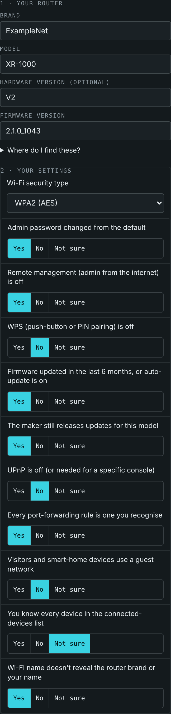 | 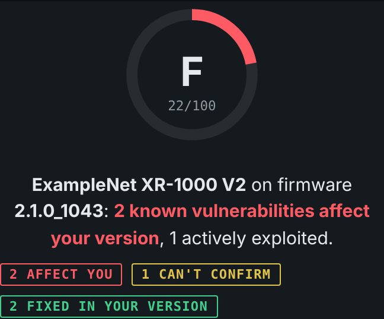 | 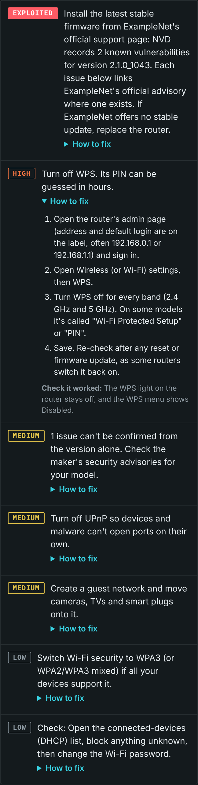 |

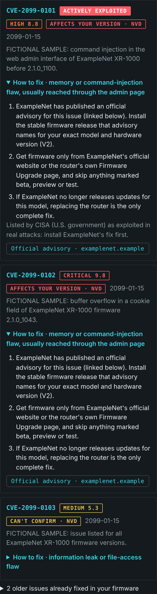

**Settings checked:** Wi-Fi security type (Open / WEP / WPA / WPA2-TKIP / WPA2-AES / WPA2+WPA3 / WPA3), default admin password, remote management, WPS, firmware updated in the last 6 months, maker still supporting the model, UPnP, port forwarding, guest network for visitors and smart-home devices, unknown devices, Wi-Fi name revealing brand or owner. "Not sure" costs half as much as "No" and turns the fix into a "Check:" item.

**Score** starts at 100 and loses points per weak setting and per known vulnerability (more for actively exploited ones). Grade: A ≥ 90, B ≥ 75, C ≥ 60, D ≥ 40, F below.

**Status chips** on the score card count vulnerabilities that **affect you**, that **can't be confirmed** from the version alone, and that are **fixed in your version**.

**Fixes** are sorted by severity. Each "How to fix" opens numbered steps and a "Check it worked" line. Menu paths are only given for your own brand (ASUS, TP-Link, NETGEAR); for other brands the steps point to your model's user guide on the maker's site.

**Vulnerabilities** list each NVD record with CVSS severity, a "Actively exploited" badge when the CISA Known Exploited Vulnerabilities catalogue lists it, its status against your firmware, the published date, and links **only to the manufacturer's official domain**.

> **Manufacturer-only fixes.** CleanSpeed never suggests beta, release-candidate or third-party firmware, never quotes version numbers from NVD as an upgrade target, and never recommends generic workarounds instead of the maker's fix. If the maker no longer releases updates, the advice is to replace the router. See [how matching works](#router-check-how-vulnerabilities-are-matched).

<br clear="right">

### 8. Network toolkit

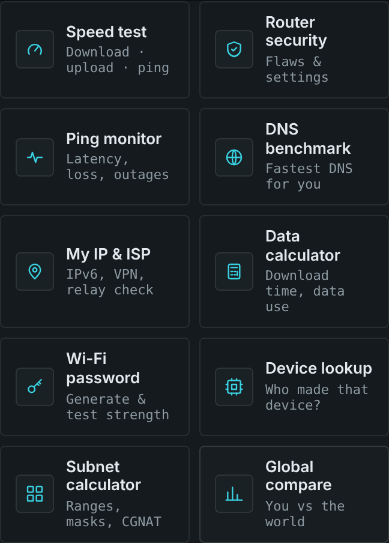

| Tool | Screen | What it does |
|---|:--:|---|
| **Ping & outage monitor** | 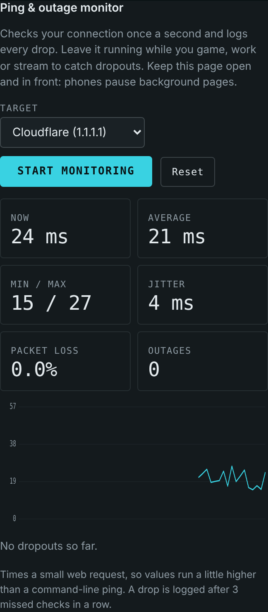 | Pings Cloudflare (1.1.1.1), Google, or the selected test server once a second. Shows now / average / min-max / jitter / packet loss / outages, with a live chart. A drop is logged after 3 missed checks in a row. Keep the page open and in front — phones pause background pages. |
| **DNS benchmark** | 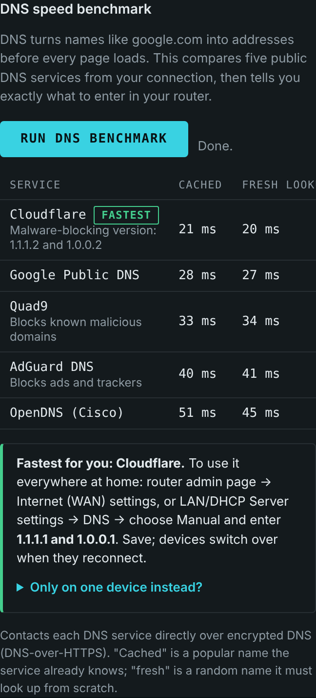 | Times Cloudflare, Google, Quad9, AdGuard and OpenDNS over encrypted DNS (DNS-over-HTTPS), for a cached and a fresh (random) name. Tells you the fastest and the exact addresses to enter in your router. |
| **My IP & ISP** | 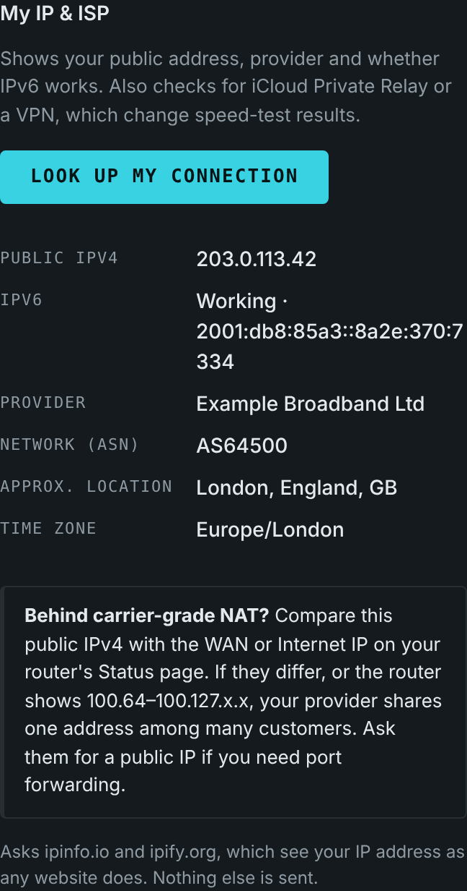 | Public IPv4 and IPv6, provider, network (ASN), approximate location, time zone. Notes when iCloud Private Relay or a VPN changes what servers see, and how to spot carrier-grade NAT. Sample shows documentation addresses (203.0.113.42, 2001:db8::/32). |
| **Data calculator** | 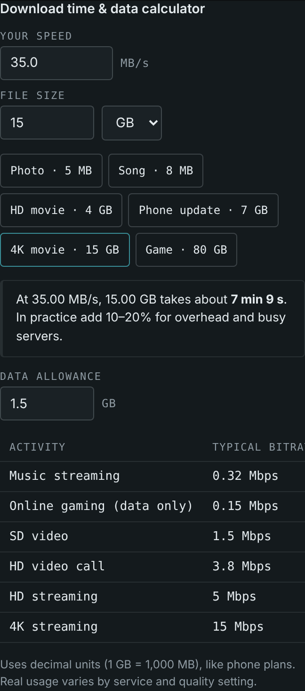 | How long a file takes at your speed (presets: photo, song, HD/4K movie, phone update, game), and how far a data allowance goes per activity. |
| **Wi-Fi password** | 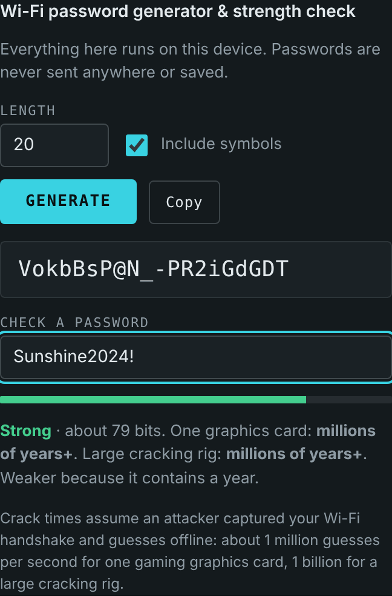 | Generates strong passwords with the browser's cryptographic random generator, and rates a password's strength with offline crack-time estimates. Runs entirely on the device; nothing is sent. |
| **Device lookup** | 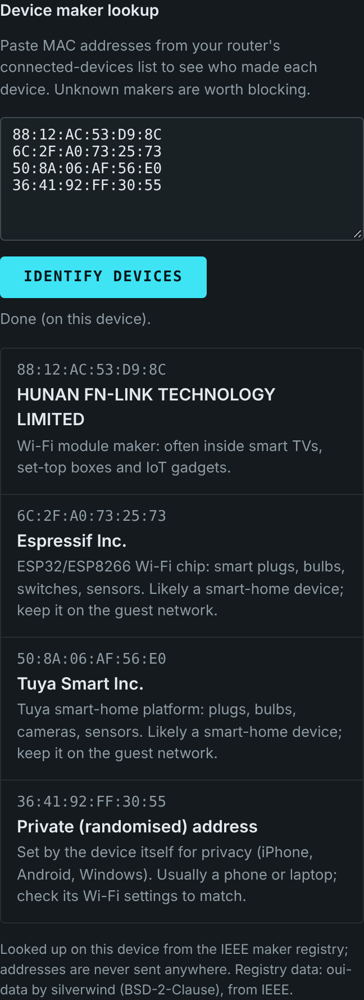 | Paste MAC addresses from your router's device list to see the maker (IEEE registry, 54,000+ entries, looked up **on your device**). Flags private/randomised addresses and hints what kind of device it is (e.g. Espressif or Tuya → smart plugs and bulbs → put them on the guest network). Sample MACs are randomly generated, not real devices. |
| **Subnet calculator** | 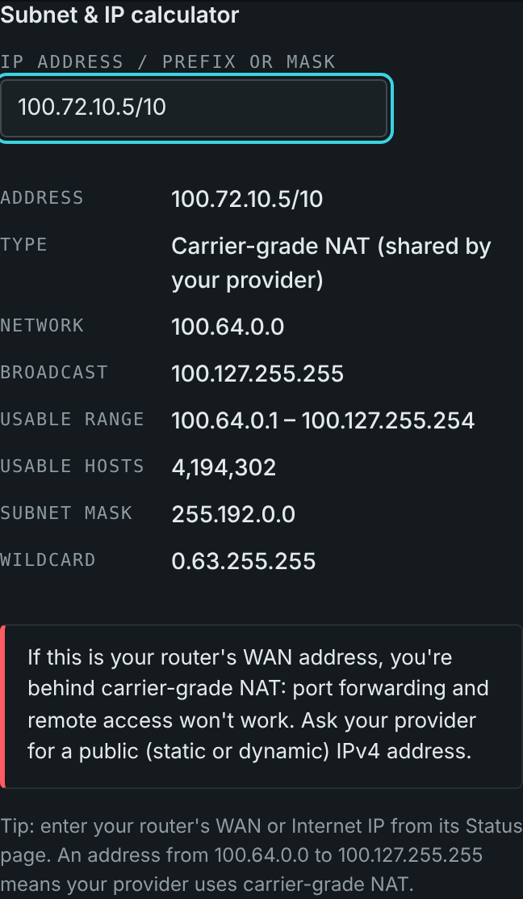 | Address/prefix or mask → network, broadcast, usable range and hosts, mask, wildcard. Detects private, carrier-grade NAT (100.64.0.0/10), loopback and link-local ranges and explains what that means for port forwarding. |
| **Global compare** | — | Jumps to [Global comparison](#4-global-comparison). |

### 9. Settings & units

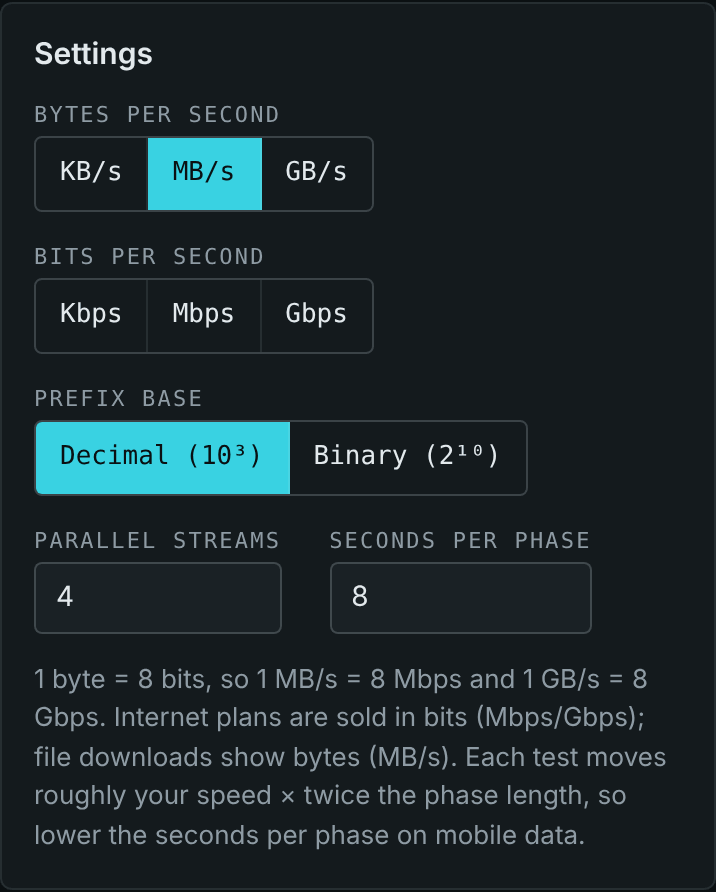

| Setting | Options | Default |
|---|---|---|
| Bytes per second | KB/s · MB/s · GB/s | MB/s |
| Bits per second | Kbps · Mbps · Gbps | — |
| Prefix base | Decimal (10³) · Binary (2¹⁰ → KiB/s, MiB/s, Mibps) | Decimal |
| Parallel streams | 1–16 | 6 |
| Seconds per phase | 4–30 | 10 |

**Converting:** 1 byte = 8 bits, so **1 MB/s = 8 Mbps**. A 500 Mbps plan is 62.5 MB/s at most. Plans are sold in bits per second; downloads show bytes per second.

All settings are stored on your device.

<br clear="right">

---

## How the measurement works

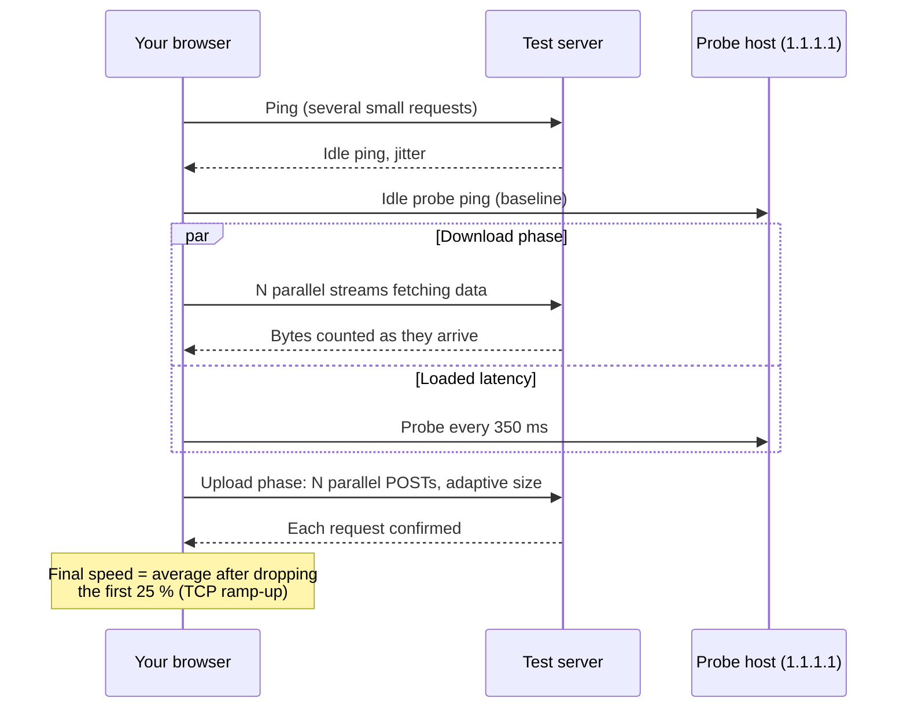

- **Download** — several parallel HTTP streams (6 by default); bytes are counted as they stream in, not when a file completes. The live figure is a 2-second sliding average.
- **Upload** — parallel `text/plain` POSTs (no CORS preflight). Request size adapts so each takes about 0.6 s. Every request has its own timeout and the phase ends on time even if a server stops answering, so a test can't hang.
- **Final figure** — the average over the phase **after discarding the first 25 %**, while TCP is still ramping up.
- **Ping & jitter** — the server's idle round-trip time and its variation.
- **Loaded ping** — measured on a separate host (`1.1.1.1/cdn-cgi/trace`) so the probe isn't queued behind the test's own traffic. Loaded ping = idle ping + rise of that probe over its own idle baseline.
- **Measurement Lab** uses the ndt7 WebSocket protocol and M-Lab's own figures.
- Data used: roughly *speed × seconds per phase* for each direction. At 35 MB/s with 10-second phases that's about 350 MB down plus the upload. Lower **Seconds per phase** on mobile data.

---

## Router check: how vulnerabilities are matched

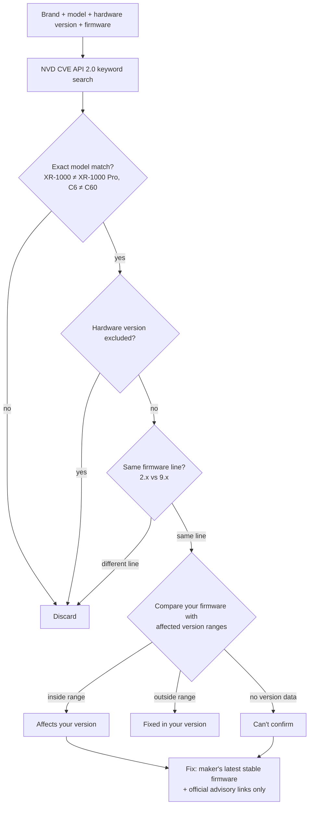

1. **Lookup** — NVD CVE API 2.0 by brand and model, live from your browser.
2. **Exact model** — a word-boundary pattern so `C6` doesn't match `C60` and `XR-1000` doesn't match `XR-1000 Pro`.
3. **Hardware version** — records limited to other hardware versions (e.g. V1 vs V3) are dropped.
4. **Firmware line** — some makers ship parallel firmware lines (e.g. 2.x and 9.x for the same model); a range written for one line is never applied to the other, and a record that only covers another line counts as not affecting you.
5. **Version compare** — numeric, piece by piece (`2.1.0_1043` vs `2.1.0_1100`).
6. **CISA KEV** — records in the Known Exploited Vulnerabilities catalogue get an "Actively exploited" badge and move to the top.
7. **Fixes** — the maker's latest **stable** firmware from its **official** support page; links filtered to official vendor domains (ASUS, TP-Link, NETGEAR, Linksys, D-Link, Ubiquiti, MikroTik, Zyxel and others); anything named beta/RC is rejected.

---

## Privacy: what leaves your device

No accounts, no ads, no analytics, no cookies, no third-party scripts. Results, history, settings and location stay in your browser's storage. The app only contacts a service when you use the feature that needs it:

| Feature | Contacts | What is sent |
|---|---|---|
| Speed test | The test server you pick; `1.1.1.1` for loaded ping; for Cloudflare, `speed.cloudflare.com/meta` and `/cdn-cgi/trace` to learn which data centre answered | Test traffic only (random bytes) |
| Measurement Lab | M-Lab locate API + test site | Test traffic; **M-Lab publishes results with your IP** (asked first) |
| LibreSpeed list refresh | librespeed.org | A request for the server list |
| Router check | services.nvd.nist.gov | Brand and model only — never your settings answers or firmware version |
| Ping monitor | 1.1.1.1, google.com or your test server | Tiny requests |
| Live ping on the map | The last test server, every 2 s, only while the map is on screen | Tiny requests; untick **Live ping** to stop |
| DNS benchmark | Cloudflare, Google, Quad9, AdGuard, OpenDNS DoH | DNS queries for test names |
| My IP & ISP | ipinfo.io, ipify.org | A request (they see your IP, like any website) |
| Device lookup | **Nothing** — uses the bundled `oui.txt` | — (api.maclookup.app only if `oui.txt` is missing) |
| Wi-Fi password, calculators, subnet | **Nothing** | — |
| Fonts | fonts.googleapis.com | Standard font request (falls back to system fonts if blocked) |

Precise location (optional) is rounded to two decimals and stored only on your device.

---

## Install, use and self-host

### Use it

Open **https://jsankr.github.io/Speedtest/** in Safari, Chrome, Edge or Firefox.

**Add to Home Screen** for an app-like icon:
- **iPhone/iPad (Safari):** Share → **Add to Home Screen**.
- **Android (Chrome):** ⋮ menu → **Add to Home screen** / **Install app**.
- **Desktop Chrome/Edge:** install icon in the address bar.

### Host your own copy

The whole app is `index.html`, plus `oui.txt` for offline device lookup.

1. Fork or copy this repository.
2. **Settings → Pages → Deploy from a branch → `main` / root.**
3. Replace `index.html` to update; Pages republishes automatically in about a minute. No settings change is needed per update.

Any static host works (Netlify, Cloudflare Pages, nginx, or opening the file directly — offline device lookup needs `oui.txt` beside it and a web server, since browsers block reading local files).

### Self-host a test server

`server/server.py` is a test server using only the Python 3.9+ standard library, with no request logging.

```bash
python3 server/server.py --port 8080
```

| Endpoint | Purpose |
|---|---|
| `GET /ping` | 204, no body |
| `GET /down?bytes=N` | N bytes of random data (max 100 MB per request) |
| `POST /up` | Reads and discards the body |
| `GET /` | Serves `../index.html` (the app) |

Open `http://<server-ip>:8080/` to run CleanSpeed against it directly — good for testing your LAN or Wi-Fi without the internet in the way. To use it from the GitHub Pages copy instead (**Change server → Your own server**), it must be served over **https** (put Caddy or nginx in front), because browsers block http requests from https pages.

---

## Troubleshooting

| Symptom | Likely cause | What to do |
|---|---|---|
| Speed stuck near **11–12 MB/s (~93 Mbps)** on a faster plan | A cable or port negotiated **100 Mbps** instead of 1 Gbps (loose or damaged cable, 4-wire cable, old switch) | Reseat or replace the cable between the ISP box and router (Cat5e or better); check the router's WAN link speed. |
| Results far below plan on Wi-Fi only | Distance, 2.4 GHz band, interference | Test next to the router on 5 GHz; compare with a cable. |
| Ping much higher than usual, or **lower than the map's physical minimum** | iCloud Private Relay or VPN is routing traffic elsewhere | Turn off Private Relay for this network (Settings → Wi-Fi → ⓘ) and retest. |
| "Upload couldn't be measured" | The server didn't confirm uploads in time (download and ping are still saved) | Change server and retest. |
| Network shows the wrong type | iPhone browsers don't expose it | Pick Wi-Fi / Mobile / Ethernet under GO; change past tests in History. |
| Router check says lookup failed | NVD unreachable or rate-limited | Wait a minute and retry. The settings part still works. |
| Device lookup shows "Unknown maker" | Private (randomised) address, or not in the IEEE registry | Check the device's Wi-Fi settings for "Private address". |
| Test uses lots of mobile data | 10-second phases at high speed | Lower **Seconds per phase** and streams in Settings. |
| CSV opens with odd characters | Very old Excel | Import as UTF-8. |

---

## Limitations

- **A browser can't do everything a native app can:** no traceroute, port scan, Wi-Fi channel scan or signal strength, and no router login. The router check relies on your answers plus public vulnerability data.
- **The map is stylised**, not a geographic map; positions are approximate.
- **Cloudflare's data centre** is located only when the browser can read Cloudflare's `/meta` or `/cdn-cgi/trace` reply; if both are blocked (some content blockers do), the map falls back to pulses around you.
- **The router check** can only be as current and precise as NVD's records. "Can't confirm" means the record lacks version data — check the maker's advisory.
- **Global medians** are third-party compilations of Ookla data with a publication lag.
- **Speeds above a few Gbps** may be limited by the device's browser and CPU rather than the line.
- `ios/` Swift sources from the original concept are not part of this repository; the web app is the maintained version.

---

## Architecture

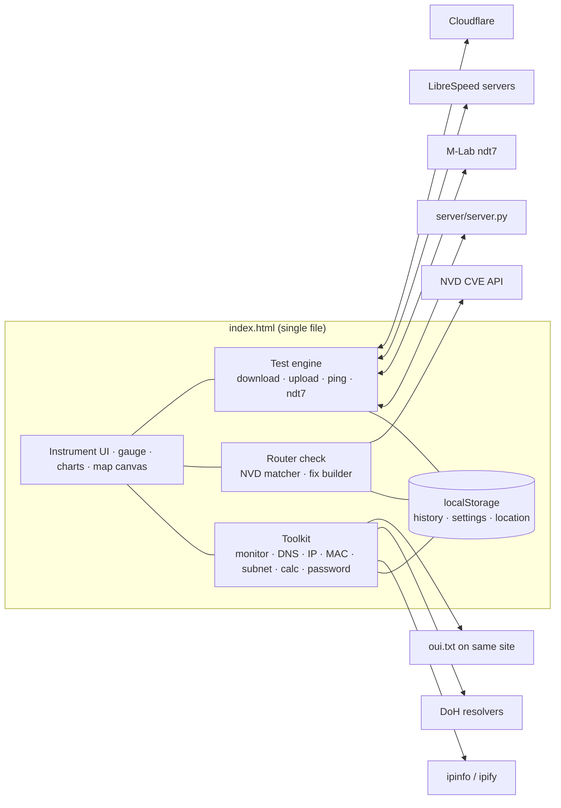

```
.
├── index.html            # the whole app: HTML, CSS and JavaScript, no dependencies
├── oui.txt               # IEEE MAC maker registry (offline device lookup)
├── oui-LICENSE.txt       # licence for oui.txt
├── DESIGN.md             # design system: tokens, components, motion, accessibility
├── server/
│   └── server.py         # optional self-hosted test server
└── docs/screenshots/     # images used in this README (sample data)
```

- No framework, no build step, no package manager. Charts, gauge and map are drawn with Canvas 2D.
- Icons and the web-app manifest are embedded as data URIs.
- Tests cancel cleanly through an `AbortController`; every network request has a timeout.

---

## Design system

The look and behaviour are written down in **[DESIGN.md](DESIGN.md)**, so every change stays consistent.

- **Instrument panel:** graphite (or light grey) flat panels with 1 px rules, IBM Plex Sans for text and IBM Plex Mono for every number and label, 6 px / 4 px corners. No glass, blur, glow, shadows or violet.
- **One meaning per colour:** cyan is always download, amber is always upload; green / yellow / red only for pass / caution / fail, and always with words.
- **One button family:** filled for the main action, outlined for the rest, red outline for Stop.
- **Motion with a job:** 120–180 ms on state changes only. No pulsing dots, looping rings, tilt or fade-in-on-scroll. Animation loops stop when nothing changes. With *Reduce motion* turned on in your system settings, transitions are cut and the map starts without animation.
- **Accessibility (WCAG 2.2 AA):** text contrast at least 4.5:1 in both themes, visible focus outlines, touch targets at least 44 px, no sideways scrolling at 320 px.

## Data sources and licences

| Data | Source | Use |
|---|---|---|
| Country and world speed medians | Ookla Speedtest Global Index (compiled by bizolaunch.com) | Global comparison, world ruler |
| Vulnerabilities | U.S. National Vulnerability Database, CVE API 2.0 | Router check |
| Exploited vulnerabilities | CISA Known Exploited Vulnerabilities catalogue (via NVD) | "Actively exploited" badge |
| MAC makers | IEEE registry via oui-data by silverwind, BSD-2-Clause (see `oui-LICENSE.txt`) | Device lookup |
| Volunteer servers | LibreSpeed | Server list |
| Streaming/call requirements | Netflix and Zoom published requirements | Readiness tiles |

CleanSpeed is not affiliated with Ookla, Speedtest®, Cloudflare, M-Lab, LibreSpeed or any router maker. Product names are their owners' trademarks.

---

## Changelog

| Commit | Change |
|---|---|
| *latest* | Redesign: instrument-panel design system ([DESIGN.md](DESIGN.md)); flat dial gauge; cyan download / amber upload; one button family; no glows, pulses or tilt; gauge stops redrawing when idle; reduced-motion support; 44 px touch targets; contrast checked in both themes; new app icon |
| `200e531` | Live map: dots driven by real bytes and measured delay, live ping after a test, Cloudflare data-centre lookup, zoom to fit short routes, labels never cover markers or the route |
| `e427d4e` | Detailed README with fictional sample screenshots (router, CVEs, speeds, history, MACs, IPs); self-host test server; map labels no longer overlap when you and the server are close; records covering only another firmware line count as "fixed in your version" |
| `f7f4ce8` | Device lookup: on-device IEEE maker registry (no third-party lookup) |
| `c4a10ea` | Router check: manufacturer-only fixes, firmware-line-aware matching |
| `6cb9e46` | Fix tests stuck at upload; add Stop and RETEST |
| `aa314a4` | Live network map, telemetry, 10-tool toolkit, router security fixes |
| `8348463` | CSV export fixed |
