# CleanSpeed — Speedtest without the bloat

Tests the internet speed of Wi-Fi, mobile data and Ethernet **without ads, trackers, accounts or bloatware**. Built with React, shipped as one HTML file, runs in any modern browser, installs to the home screen like an app.

**▶ Run it: https://jsankr.github.io/Speedtest/**

<p>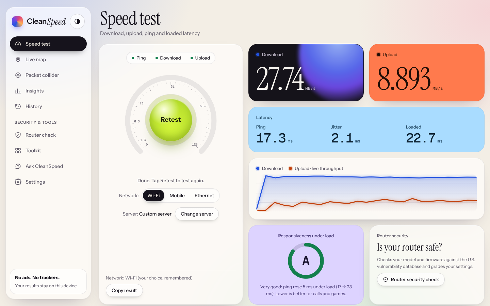</p>

<p>
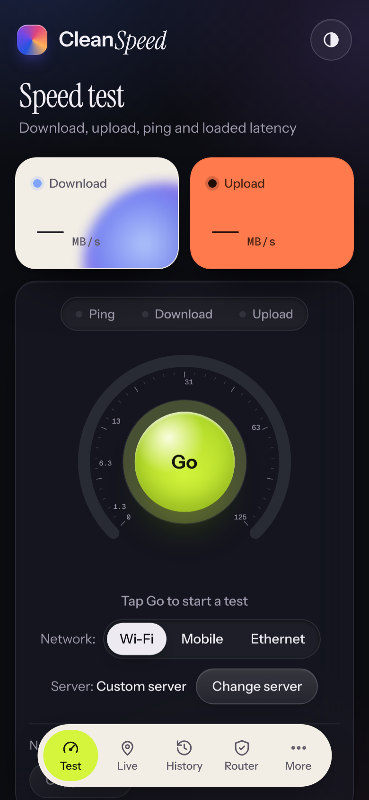
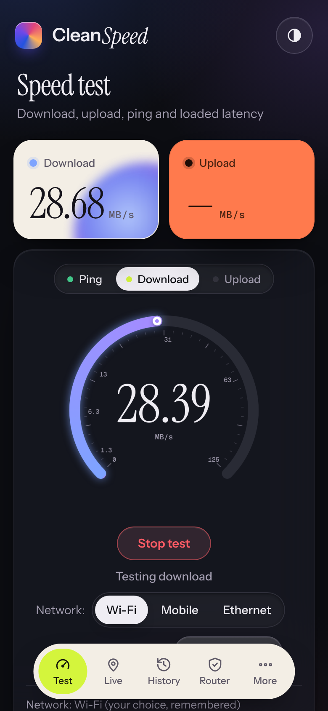
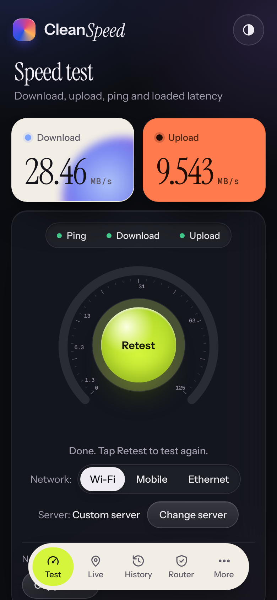
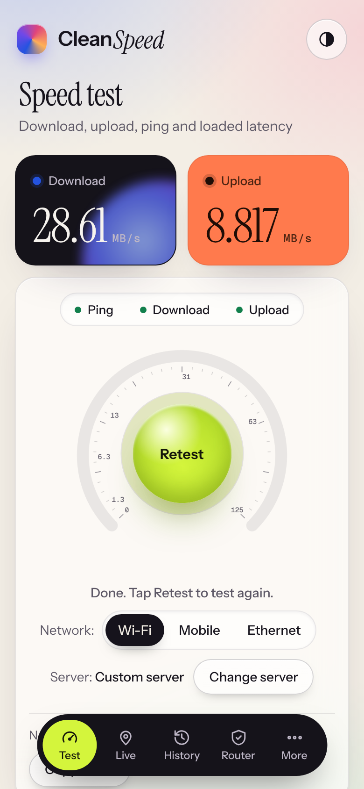
</p>

> **About the screenshots.** Every screen below uses **sample data**. They were captured in headless Chrome at iPhone width (390 pt, 2×) against a local stand-in server paced to about 35 MB/s down and 12 MB/s up, with simulated responses for the vulnerability database, IP lookup and DNS services. MAC addresses in the device-lookup screen are randomly generated (makers' registered prefixes with random device bytes, plus a random private address), so they don't belong to any real device. IP addresses come from the reserved documentation ranges (203.0.113.0/24, 2001:db8::/32). The router report uses a **fictional** router — brand *ExampleNet*, model *XR-1000*, hardware V2, firmware 2.1.0_1043 — with five made-up vulnerability records (`CVE-2099-0101` to `-0105`, advisory links on the reserved `.example` domain) so every status appears. Speeds, history, locations and IP details are invented too. Nothing here describes a real person's connection, router or devices.

---

## Contents

1. [What it does](#what-it-does)
2. [Screens](#screens)
   - [Speed test](#1-speed-test) · [Live network map](#2-live-network-map--telemetry) · [Insights](#3-result-insights) · [Global comparison](#4-global-comparison) · [Servers](#5-test-servers) · [History](#6-history--csv-export)
   - [Router security check](#7-router-security-check) · [Toolkit](#8-network-toolkit) · [Settings](#9-settings--units)
3. [How the measurement works](#how-the-measurement-works)
4. [Router check: how vulnerabilities are matched](#router-check-how-vulnerabilities-are-matched)
5. [Privacy: what leaves your device](#privacy-what-leaves-your-device)
   - [Security assessment (OWASP Top 10:2025)](#security-assessment-owasp-top-102025)
6. [Install, use and self-host](#install-use-and-self-host)
7. [Troubleshooting](#troubleshooting)
8. [Limitations](#limitations)
9. [Architecture](#architecture) · [Design system](#design-system) · [Accessibility](#accessibility) · [Testing](#testing)
10. [Data sources and licences](#data-sources-and-licences)
11. [Changelog](#changelog)

---

## What it does

| Area | Features |
|---|---|
| **Speed test** | Download, upload, idle ping, jitter and **loaded ping** (latency while the line is busy). Live gauge and throughput chart. Stop at any time; **Retest** after a run. |
| **Units** | Bytes or bits per second: KB/s, MB/s, GB/s, Kbps, Mbps, Gbps. Decimal (1000) or binary (1024, shown as MiB/s, Mibps). |
| **Servers** | Automatic (lowest ping), Cloudflare (anycast), Measurement Lab (ndt7), 22 LibreSpeed volunteer servers worldwide, or your own server. "Measure ping to all" compares them. |
| **Packet collider** | A 3D CMS/LHC-style collider view of the test: bunches collide for every chunk really received, tracks curl through the calorimeters, and the detector opens up at the end with ping, download and upload on its parts. |
| **Live map** | Route from you to the test server with animated data flow, live download/upload/ping tiles and a telemetry timeline. |
| **Insights** | Responsiveness grade (A+ to F) from loaded ping, what the connection can handle (streaming, calls, gaming, backups), your place among 100+ countries. |
| **Global comparison** | Your result against the world and national medians (Ookla Speedtest Global Index), for broadband or mobile. |
| **History** | Every test saved on your device, trend chart, filter by network, editable network label, CSV export. |
| **Router security** | Scores your router settings, looks up known vulnerabilities for your exact model and firmware in the U.S. National Vulnerability Database (NVD), and gives step-by-step fixes — **manufacturer-approved fixes only**. |
| **Help assistant** | "Ask CleanSpeed": a built-in assistant with a knowledge base about the app. Ask in plain words, or press *Diagnose my last test* to check your last saved result for a 100 Mbps cap, bufferbloat, high ping or jitter, and lopsided upload. Runs entirely in the page; nothing is sent. |
| **Toolkit** | Ping & outage monitor, DNS benchmark, My IP & ISP, data/time calculator, Wi-Fi password generator & strength check, device (MAC) lookup, subnet calculator, global compare. |
| **App** | React app built into a single HTML file. "Aurora Bento" design (see [DESIGN.md](DESIGN.md)): sidebar on laptops, floating tab bar on phones and tablets, one screen per area, light, dark or match-device theme, reduced-motion support, installable, no third-party scripts, no analytics. |

---

## Screens

### 1. Speed test

| Ready | Testing | Done |
|:--:|:--:|:--:|
|  |  |  |
| Tap **Go**. The tiles show the most recent saved result. | The gauge and chart update live. **Stop test** cancels instantly. | **Retest** replaces GO. The chart overlays download (blue) and upload (coral). |

- **Steps** at the top light up in order: Ping → Download → Upload.
- **Network** — pick Wi-Fi, Mobile or Ethernet. Browsers on iPhone don't reveal the connection type, so CleanSpeed asks once and remembers. Where the browser does report it (some Android/desktop Chrome builds), it's detected automatically.
- **Router security check** has its own tile on the home screen and its own screen (see [section 7](#7-router-security-check)).
- **Screens:** Speed test, Live map, Packet collider, Insights, History, Router check, Toolkit, Ask CleanSpeed and Settings. A test keeps running while you switch between them.
- **Copy result** copies a one-line summary, e.g. `Download 35.19 MB/s · Upload 12.44 MB/s · Ping … · Server Frankfurt, Germany (Clouvider)` (sample).
- **Ping / Jitter / Loaded**: idle round-trip time, its variation, and round-trip time while the download is running.

### 2. Live network map & telemetry

| During download | During upload |
|:--:|:--:|
| 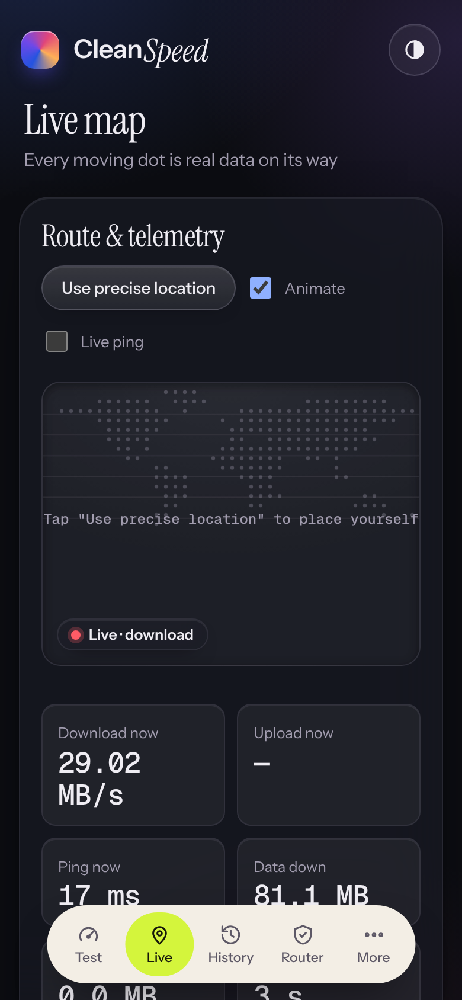 | 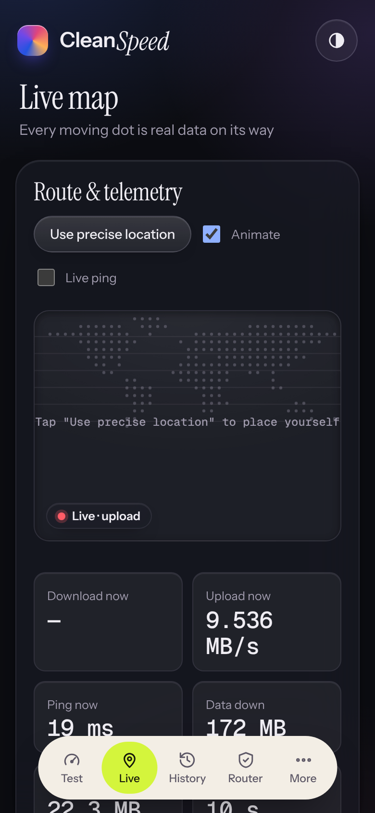 |

- **Map** — a stylised dot-matrix world, zoomed to fit the route. Every moving dot is **real data**: a dot leaves only when that much data has actually been received (download, **server → you**, blue) or sent (upload, **you → server**, coral), counted from the same byte counters as the result. The legend under the map says how much each dot stands for (16 KB to 256 MB, so there are never more than about 50 a second).
- **Timing** — each dot's trip lasts the measured one-way delay (ping ÷ 2) shown **20× slower**, so the eye can follow it; a ring flashes when it lands. Pings (green) go out and come back over their measured round-trip time.
- **Live ping** — after a test, while the map is on screen and the page is in front, the app pings the last server every 2 seconds and animates each one. Untick **Live ping** to stop; the setting is remembered.
- **Cloudflare** — the app asks Cloudflare which data centre answered (its `/meta` and `/cdn-cgi/trace` endpoints) and draws the route to that city. If you and that data centre are in the same area, the server is drawn a short way off and labelled *near you*.
- **Your position** comes from your time zone by default, or from Cloudflare's rough estimate based on your IP during a Cloudflare test (used for the drawing only, never stored). Tap **Use precise location** for GPS (rounded to ~1 km and kept on your device), or run **My IP & ISP** to use the IP-based city.
- **Live tiles** — download now, upload now, ping now, data down, data up, elapsed.
- **Timeline** — download and upload on the left axis, ping (orange dots) on the right axis, with phase bands.
- **Route facts** — straight-line distance and the physical minimum round trip (light in fibre ≈ 200 km per ms). If your ping is *lower* than that minimum, you weren't really connected to that city (often a VPN or iCloud Private Relay).

### Packet collider (3D)

| During download | After the test: teardown |
|:--:|:--:|
| 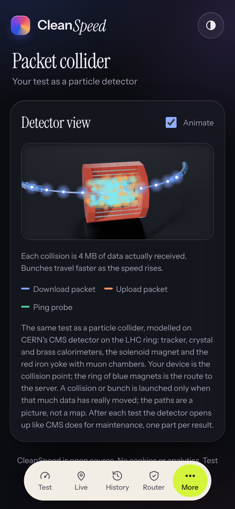 | 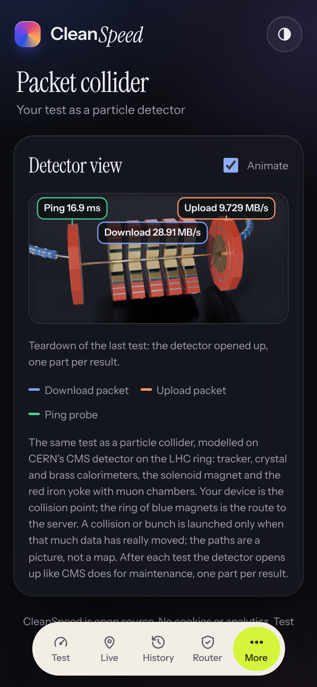 |

The same test drawn as a particle collider, modelled on the real structure of CERN's CMS detector sitting on the LHC ring. The detector, the GO sphere and the dial's metal bezel are **rendered in Blender** (Cycles path tracing, physical materials: painted iron, brushed aluminium, polished steel, brass, lead-tungstate crystal glass) and shipped as small WebP plates in `assets/3d/`. The live data — bunches, tracks, hits, probes, labels — is drawn on top in the browser, projected through the exact Blender camera (`assets/3d/scene.json`), so packets ride the rendered beam pipe. If the plates are missing (for example the single-file download), the app falls back to its own canvas-drawn 3D model, so nothing breaks.

- **The model, from the beam outwards:** silicon tracker, crystal electromagnetic calorimeter (teal), brass hadron calorimeter, the superconducting solenoid (silver) and the red iron return yoke with grey muon chambers, built as a 12-sided barrel of five wheels plus two endcaps. The wedge facing you is cut away, like an event display, so the collision point is visible. Blue dipole magnets mark the ring; the ring is the route to the test server and the collision point is your device.
- **Download:** for each chunk really received (the note under the picture gives the size), two blue bunches race in along the beam pipe from both sides and collide in the centre. Tracks curl in the magnetic field and light up where they stop: electrons in the crystal calorimeter, hadrons in the brass one.
- **Upload:** a coral bunch leaves the centre along the pipe for each chunk really sent.
- **Ping:** green probes run along the pipe and back over each measured round trip (slowed 20×), and the time flashes in the centre.
- **Rendering pipeline:** `blender/render_plates.py` builds the scene in code and `.github/workflows/render.yml` renders it with Blender 4.2 LTS on GitHub Actions whenever the script changes, then commits the plates. Nine teardown frames are rendered and cross-faded as the detector opens. About 1 MB in total, loaded after the page is usable.
- **Teardown:** when the test ends, the detector opens the way CMS is opened for maintenance — endcaps slide out along the beam and the barrel wheels part — and each part carries a result: ping and jitter, download, upload. The last saved result is shown this way when the page opens.
- **Cost:** the detector is drawn once and reused, only the particles move; at most 30 frames a second during a test and paused off screen, so it doesn't compete with the measurement. *Animate* turns it off; *Reduce motion* turns it off by default. Screen readers get the result as text.

### Help assistant

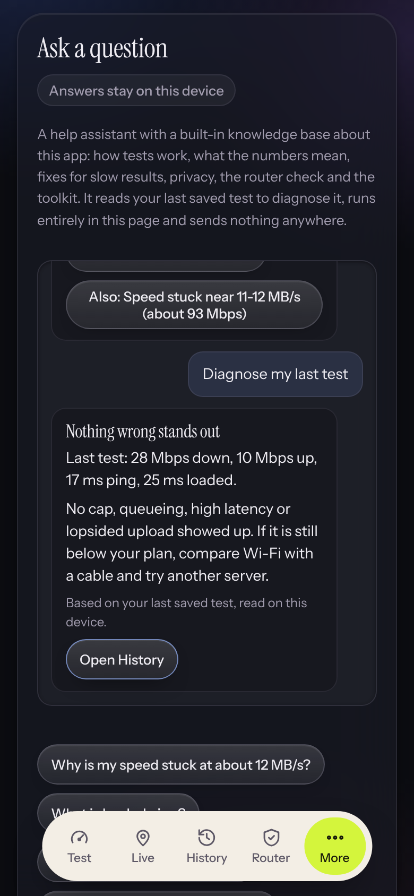

An on-device help agent at the bottom of the page. It is deliberately **not** a hosted chatbot: a hosted model needs a server and an API key and would send every question off your device, which this app promises never to do. Instead:

- **Knowledge stack:** about 40 curated entries (how a test is measured, units, slow-result causes, privacy, the router check, the collider, each toolkit tool), each with the documentation section it comes from, shown under every answer.
- **Retrieval:** stemmed keywords, synonyms and IDF-weighted scoring over each entry's title, keywords and text. No network, no model download, no storage of your questions.
- **Diagnosis:** reads your last saved test and applies the rules from the Troubleshooting table.
- **Honest limits:** when nothing matches well it says it doesn't know instead of guessing, and offers topics.
- **Action buttons** jump to the tool or section the answer is about.

### 3. Result insights

| Dark | Light |
|:--:|:--:|
| 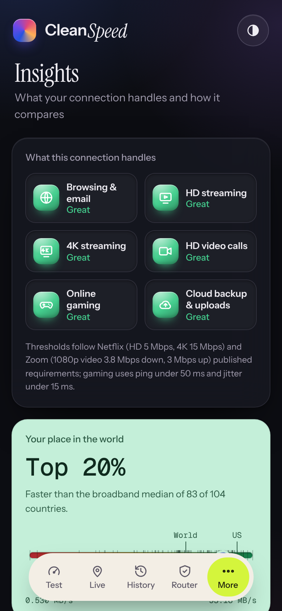 | 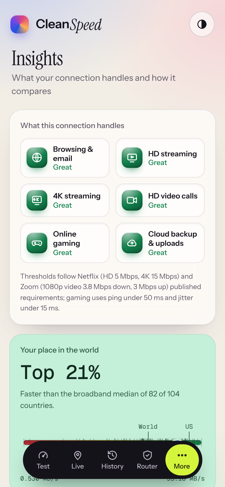 |

**Responsiveness under load** grades how much ping rises while the line is busy (bufferbloat):

| Rise in ping under load | Grade |
|---|---|
| under 5 ms | A+ Excellent |
| 5–29 ms | A Very good |
| 30–59 ms | B Good |
| 60–199 ms | C Fair |
| 200–399 ms | D Poor |
| 400 ms or more | F Very poor |

**What this connection handles** uses published requirements: Netflix HD 5 Mbps and 4K 15 Mbps; Zoom 1080p video 3.8 Mbps down / 3 Mbps up; gaming needs ping under 50 ms and jitter under 15 ms.

**Your place in the world** places the download on a ruler of national broadband (or mobile) medians, with markers for the world and your country.

### 4. Global comparison

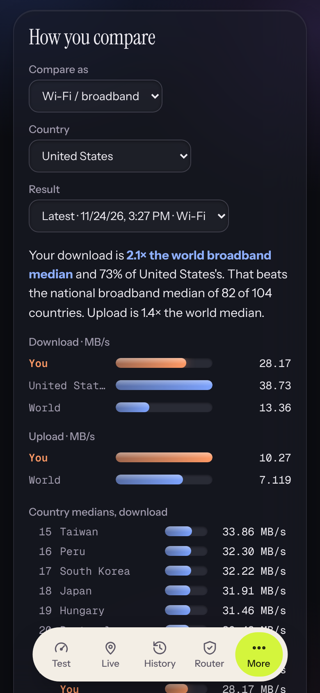

- **Compare as** Wi-Fi / broadband or mobile.
- **Country** defaults to the one matching your time zone; change it freely.
- **Result** picks any saved test, not just the latest.
- Bars compare you with your country and the world median for download and upload, followed by the full country ranking with your position inserted.
- Source line under the chart: Ookla Speedtest Global Index country medians (March 2026) and global medians (November 2025), compiled by bizolaunch.com. These are medians of many users' tests, not guaranteed speeds — treat the comparison as a guide.

<br clear="right">

### 5. Test servers

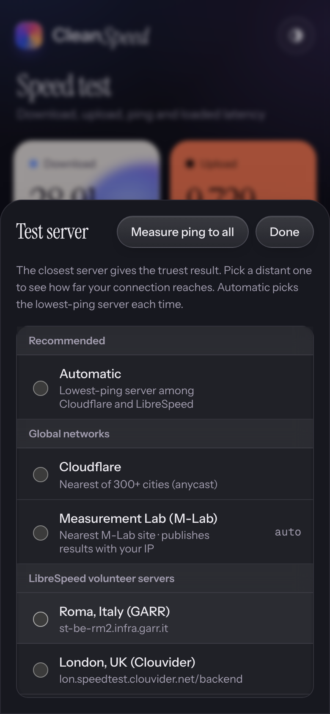

Open with **Change server**.

| Server | What it is | Notes |
|---|---|---|
| **Automatic** | Lowest ping among Cloudflare and LibreSpeed | Default |
| **Cloudflare** | `speed.cloudflare.com`, anycast to the nearest of 300+ cities | The app asks Cloudflare which data centre answered, so the map shows the real route |
| **Measurement Lab** | Nearest M-Lab site via the ndt7 protocol | **Asks before use**: M-Lab publishes test results, including your IP address, as open data |
| **LibreSpeed** | 22 volunteer servers (Europe, Americas, Asia, Oceania) | List refreshed from librespeed.org when reachable; a built-in snapshot otherwise |
| **Your own server** | Any URL running `server/server.py` | See [Self-host a test server](#self-host-a-test-server) |

**Measure ping to all** pings every server so you can pick the closest. A distant server shows how your connection copes with long routes.

<br clear="right">

### 6. History & CSV export

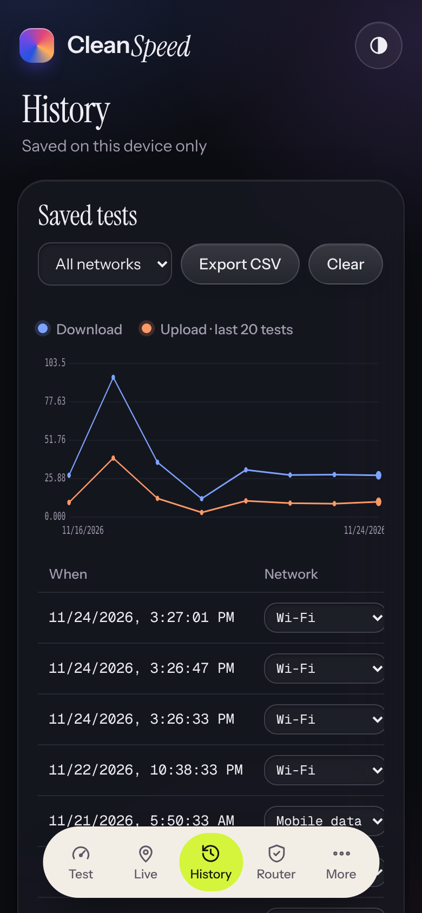

- Up to **300 tests** stored in your browser (`localStorage`) — never uploaded.
- **Trend chart** of the last 20 tests. The sample history is invented: Wi-Fi tests around 31–37 MB/s with a few mobile-data tests in between.
- **Filter** by network; **change the network** of any past test from its drop-down.
- **Export CSV** opens the share sheet on phones (Save to Files, Mail…) and downloads a file elsewhere. UTF-8 with BOM so Excel opens it correctly. Columns:

```
timestamp,network,download_Bps,upload_Bps,download_Mbps,upload_Mbps,ping_ms,jitter_ms,loaded_ping_ms,server
```

- **Clear** deletes the history from this device.

<br clear="right">

### 7. Router security check

Tap **Router security check** under GO. (Screens below: fictional ExampleNet XR-1000 with made-up `CVE-2099-…` records.) It has two parts: your router (brand, model, hardware version, firmware) and ten questions about your settings.

| 1 · Form | 2 · Score | 3 · Fixes |
|:--:|:--:|:--:|
| 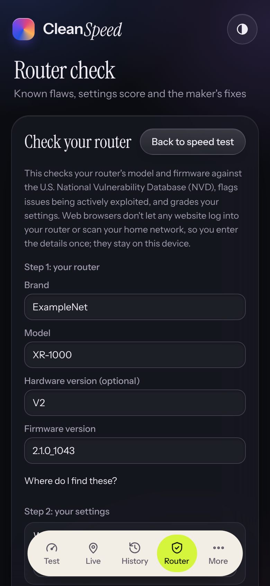 | 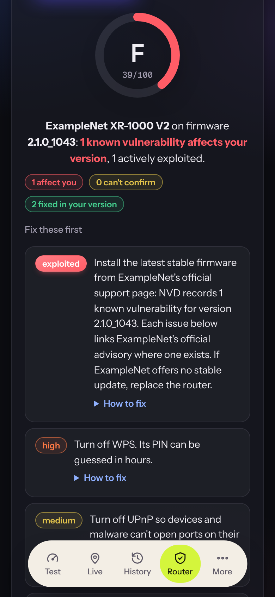 | 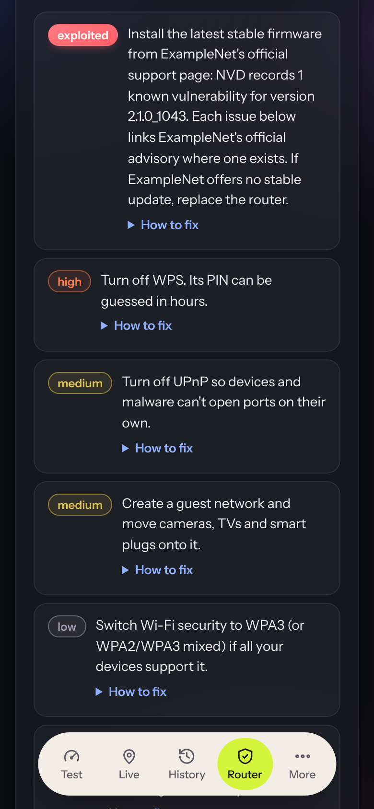 |

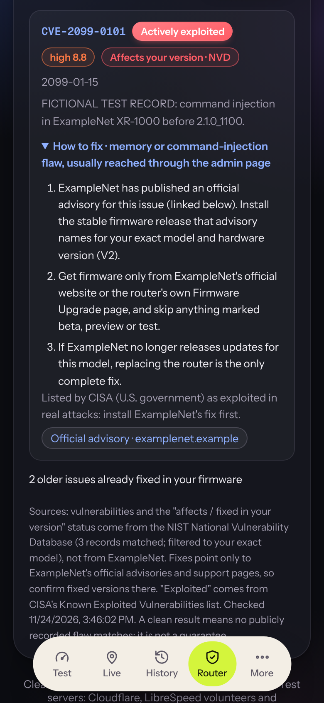

**Settings checked:** Wi-Fi security type (Open / WEP / WPA / WPA2-TKIP / WPA2-AES / WPA2+WPA3 / WPA3), default admin password, remote management, WPS, firmware updated in the last 6 months, maker still supporting the model, UPnP, port forwarding, guest network for visitors and smart-home devices, unknown devices, Wi-Fi name revealing brand or owner. "Not sure" costs half as much as "No" and turns the fix into a "Check:" item.

**Score** starts at 100 and loses points per weak setting and per known vulnerability (more for actively exploited ones). Grade: A ≥ 90, B ≥ 75, C ≥ 60, D ≥ 40, F below.

**Status chips** on the score card count vulnerabilities that **affect you**, that **can't be confirmed** from the version alone, and that are **fixed in your version**.

**Fixes** are sorted by severity. Each "How to fix" opens numbered steps and a "Check it worked" line. Menu paths are only given for your own brand (ASUS, TP-Link, NETGEAR); for other brands the steps point to your model's user guide on the maker's site.

**Vulnerabilities** list each NVD record with CVSS severity, a "Actively exploited" badge when the CISA Known Exploited Vulnerabilities catalogue lists it, its status against your firmware, the published date, and links **only to the manufacturer's official domain**.

> **Manufacturer-only fixes.** CleanSpeed never suggests beta, release-candidate or third-party firmware, never quotes version numbers from NVD as an upgrade target, and never recommends generic workarounds instead of the maker's fix. If the maker no longer releases updates, the advice is to replace the router. See [how matching works](#router-check-how-vulnerabilities-are-matched).

<br clear="right">

### 8. Network toolkit

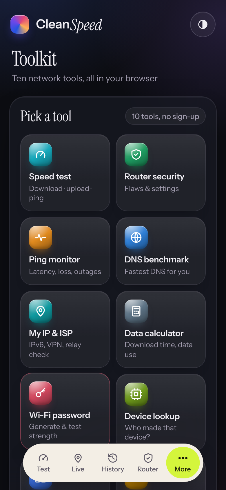

| Tool | Screen | What it does |
|---|:--:|---|
| **Ping & outage monitor** | 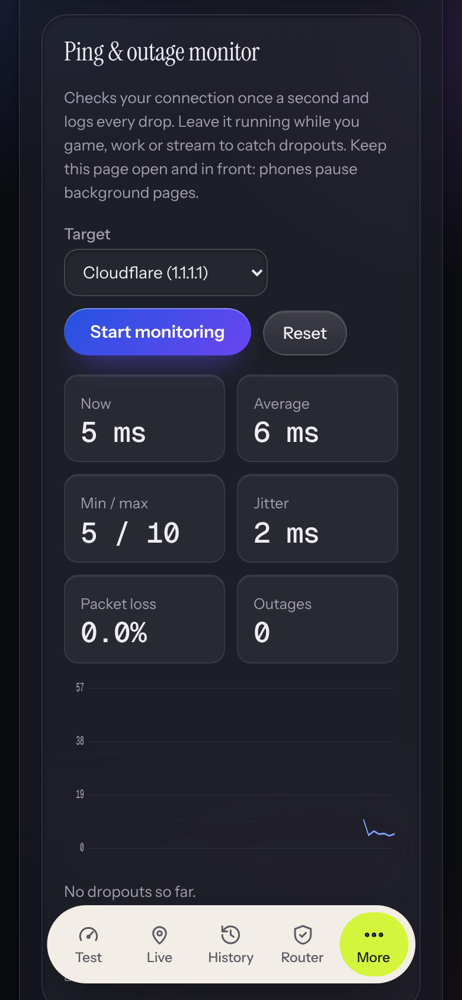 | Pings Cloudflare (1.1.1.1), Google, or the selected test server once a second. Shows now / average / min-max / jitter / packet loss / outages, with a live chart. A drop is logged after 3 missed checks in a row. Keep the page open and in front — phones pause background pages. |
| **DNS benchmark** | 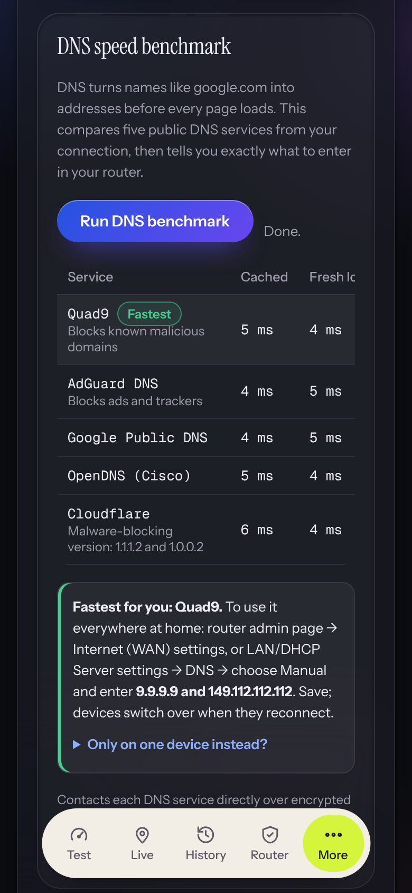 | Times Cloudflare, Google, Quad9, AdGuard and OpenDNS over encrypted DNS (DNS-over-HTTPS), for a cached and a fresh (random) name. Tells you the fastest and the exact addresses to enter in your router. |
| **My IP & ISP** | 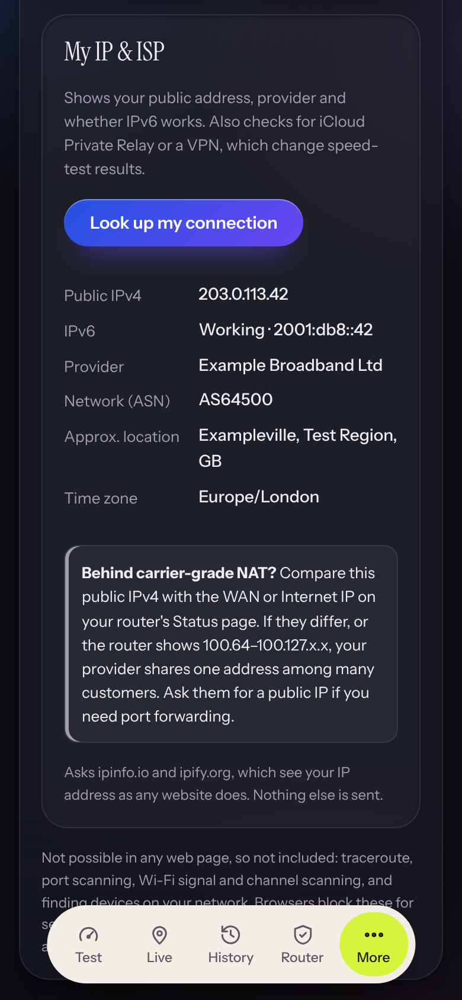 | Public IPv4 and IPv6, provider, network (ASN), approximate location, time zone. Notes when iCloud Private Relay or a VPN changes what servers see, and how to spot carrier-grade NAT. Sample shows documentation addresses (203.0.113.42, 2001:db8::/32). |
| **Data calculator** | 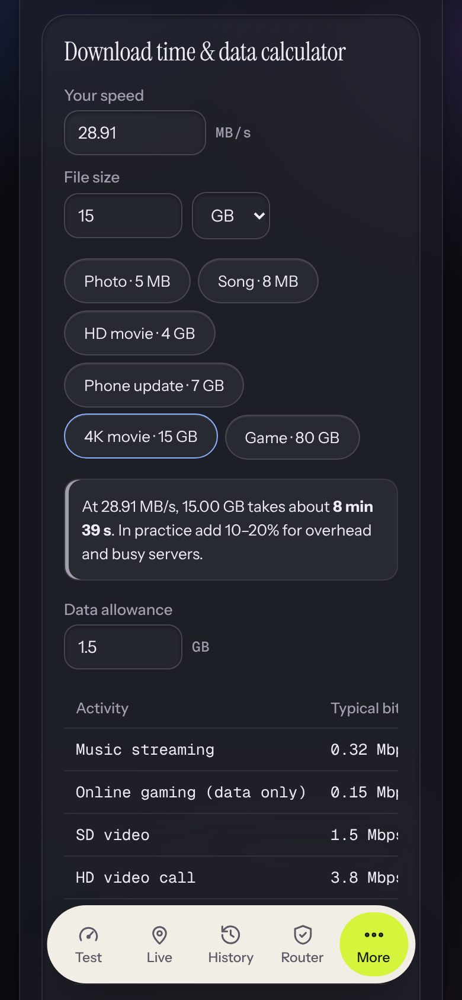 | How long a file takes at your speed (presets: photo, song, HD/4K movie, phone update, game), and how far a data allowance goes per activity. |
| **Wi-Fi password** | 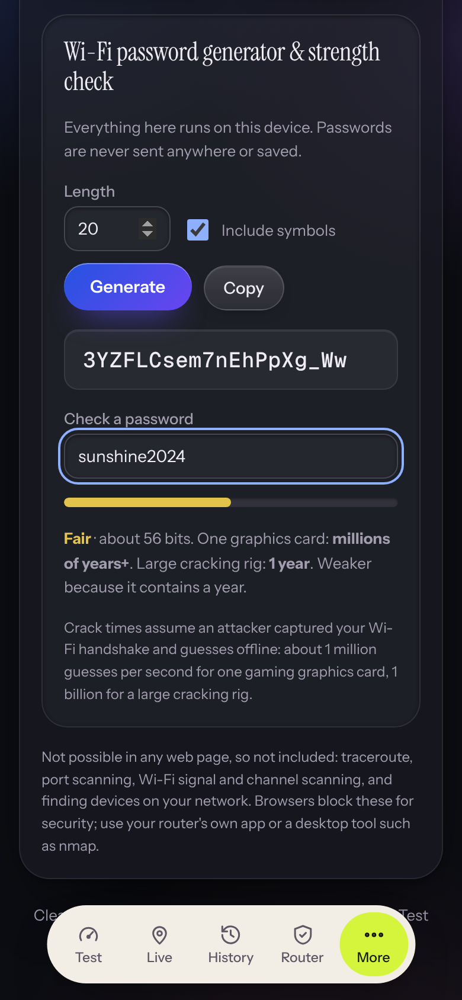 | Generates strong passwords with the browser's cryptographic random generator, and rates a password's strength with offline crack-time estimates. Runs entirely on the device; nothing is sent. |
| **Device lookup** | 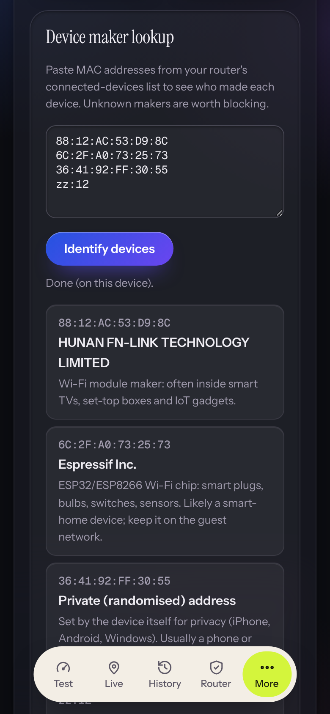 | Paste MAC addresses from your router's device list to see the maker (IEEE registry, 54,000+ entries, looked up **on your device**). Flags private/randomised addresses and hints what kind of device it is (e.g. Espressif or Tuya → smart plugs and bulbs → put them on the guest network). Sample MACs are randomly generated, not real devices. |
| **Subnet calculator** | 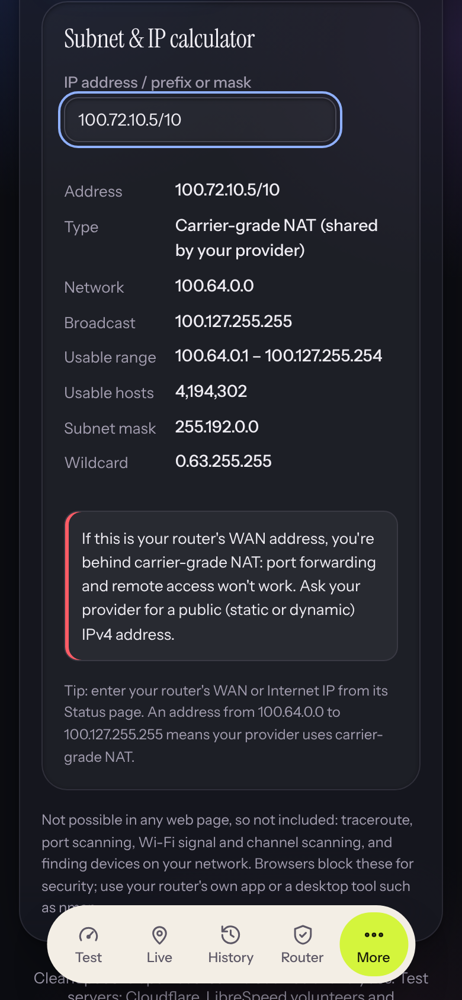 | Address/prefix or mask → network, broadcast, usable range and hosts, mask, wildcard. Detects private, carrier-grade NAT (100.64.0.0/10), loopback and link-local ranges and explains what that means for port forwarding. |
| **Global compare** | — | Jumps to [Global comparison](#4-global-comparison). |

### 9. Settings & units

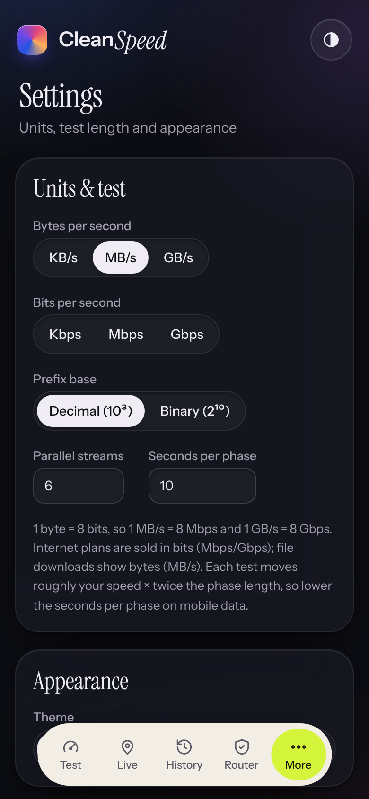

| Setting | Options | Default |
|---|---|---|
| Bytes per second | KB/s · MB/s · GB/s | MB/s |
| Bits per second | Kbps · Mbps · Gbps | — |
| Prefix base | Decimal (10³) · Binary (2¹⁰ → KiB/s, MiB/s, Mibps) | Decimal |
| Parallel streams | 1–16 | 6 |
| Seconds per phase | 4–30 | 10 |

**Converting:** 1 byte = 8 bits, so **1 MB/s = 8 Mbps**. A 500 Mbps plan is 62.5 MB/s at most. Plans are sold in bits per second; downloads show bytes per second.

All settings are stored on your device.

<br clear="right">

---

## How the measurement works

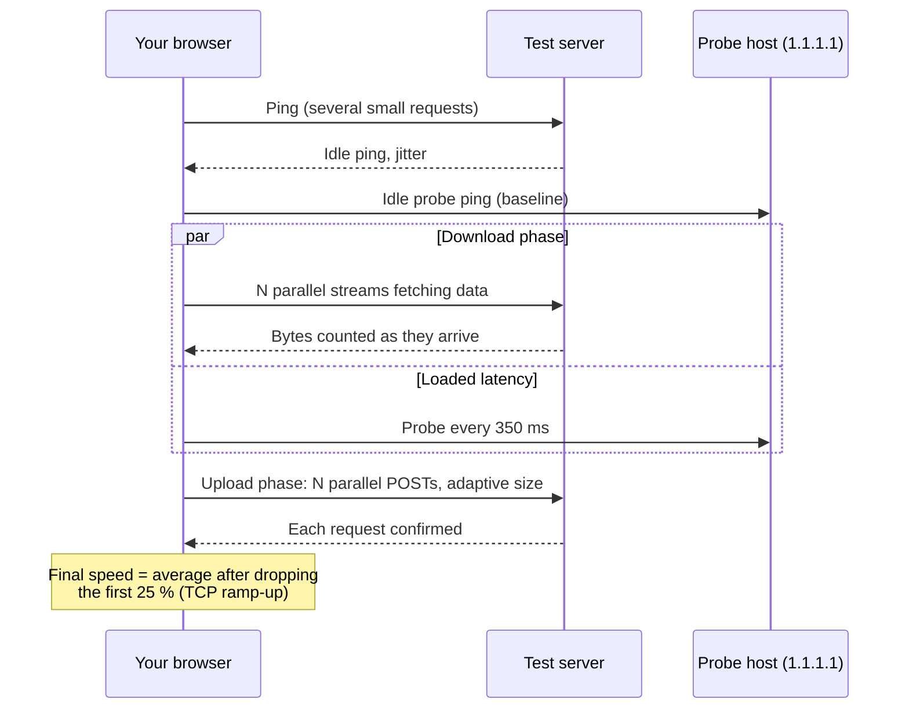

- **Download** — several parallel HTTP streams (6 by default); bytes are counted as they stream in, not when a file completes. The live figure is a 2-second sliding average.
- **Upload** — parallel `text/plain` POSTs (no CORS preflight). Request size adapts so each takes about 0.6 s. Every request has its own timeout and the phase ends on time even if a server stops answering, so a test can't hang.
- **Final figure** — the average over the phase **after discarding the first 25 %**, while TCP is still ramping up.
- **Ping & jitter** — the server's idle round-trip time and its variation.
- **Loaded ping** — measured on a separate host (`1.1.1.1/cdn-cgi/trace`) so the probe isn't queued behind the test's own traffic. Loaded ping = idle ping + rise of that probe over its own idle baseline.
- **Measurement Lab** uses the ndt7 WebSocket protocol and M-Lab's own figures.
- Data used: roughly *speed × seconds per phase* for each direction. At 35 MB/s with 10-second phases that's about 350 MB down plus the upload. Lower **Seconds per phase** on mobile data.

---

## Router check: how vulnerabilities are matched

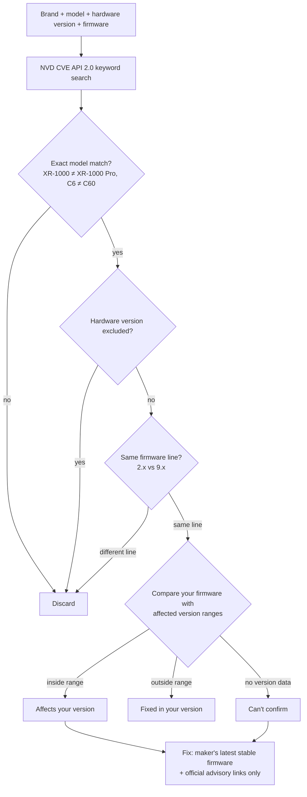

1. **Lookup** — NVD CVE API 2.0 by brand and model, live from your browser.
2. **Exact model** — a word-boundary pattern so `C6` doesn't match `C60` and `XR-1000` doesn't match `XR-1000 Pro`.
3. **Hardware version** — records limited to other hardware versions (e.g. V1 vs V3) are dropped.
4. **Firmware line** — some makers ship parallel firmware lines (e.g. 2.x and 9.x for the same model); a range written for one line is never applied to the other, and a record that only covers another line counts as not affecting you.
5. **Version compare** — numeric, piece by piece (`2.1.0_1043` vs `2.1.0_1100`).
6. **CISA KEV** — records in the Known Exploited Vulnerabilities catalogue get an "Actively exploited" badge and move to the top.
7. **Fixes** — the maker's latest **stable** firmware from its **official** support page; links filtered to official vendor domains (ASUS, TP-Link, NETGEAR, Linksys, D-Link, Ubiquiti, MikroTik, Zyxel and others); anything named beta/RC is rejected.

---

## Privacy: what leaves your device

No accounts, no ads, no analytics, no cookies, no third-party scripts. Results, history, settings and location stay in your browser's storage. The app only contacts a service when you use the feature that needs it:

| Feature | Contacts | What is sent |
|---|---|---|
| Speed test | The test server you pick; `1.1.1.1` for loaded ping; for Cloudflare, `speed.cloudflare.com/meta` and `/cdn-cgi/trace` to learn which data centre answered | Test traffic only (random bytes) |
| Measurement Lab | M-Lab locate API + test site | Test traffic; **M-Lab publishes results with your IP** (asked first) |
| LibreSpeed list refresh | librespeed.org | A request for the server list |
| Router check | services.nvd.nist.gov | Brand and model only — never your settings answers or firmware version |
| Ping monitor | 1.1.1.1, google.com or your test server | Tiny requests |
| Live ping on the map | The last test server, every 2 s, only while the map is on screen | Tiny requests; untick **Live ping** to stop |
| DNS benchmark | Cloudflare, Google, Quad9, AdGuard, OpenDNS DoH | DNS queries for test names |
| My IP & ISP | ipinfo.io, ipify.org | A request (they see your IP, like any website) |
| Device lookup | **Nothing** — uses the bundled `oui.txt` | — (api.maclookup.app only if `oui.txt` is missing) |
| Wi-Fi password, calculators, subnet | **Nothing** | — |
| Fonts | **Nothing** — the typefaces ship with the app | — |

Precise location (optional) is rounded to two decimals and stored only on your device.

---

## Security assessment (OWASP Top 10:2025)

**Overall: 8 of 10 categories compliant, 2 partially compliant with accepted, documented risk; 9 findings, all fixed and covered by automated tests.**

| | |
|---|---|
| **Date** | 24 November 2026 (CleanSpeed 2, React build) |
| **Standard** | OWASP Top 10:2025, the current edition (there is no 2026 edition) |
| **Scope** | The built app (`index.html`), the self-hosted test server (`server/server.py`), the build and CI supply chain (`app/`, `.github/workflows/`) |
| **Method** | Grey-box: source review of every place the app writes HTML, dependency audit (`npm audit`), and an automated attack suite run in real browsers. The suite feeds hostile data through every outside source (vulnerability database, IP lookup), tampers with everything the app saves on the device, sends hostile input to every tool, and probes the server with path traversal, malformed and oversized requests and idle connections. |
| **Not in scope** | Cloudflare, LibreSpeed, M-Lab, NVD, ipinfo and ipify themselves; GitHub's hosting; denial-of-service load testing. This is a focused self-assessment, not a substitute for an independent penetration test. |
| **Reproduce** | `python tests/run.py --only security` (23 checks; CI runs them in Chromium, Firefox and WebKit on every push) |

### Compliance by category

| OWASP 2025 | Status | Why, and the evidence |
|---|---|---|
| **A01** Broken Access Control | ✅ Compliant | No accounts, roles or server-side data to reach. The server only serves an allowlist of files (path-traversal probes refused); screen links accept only known screens; every new-tab link is `rel=noopener`. |
| **A02** Security Misconfiguration | 🟡 Partial | **Fixed:** strict Content-Security-Policy, `no-referrer`, security headers and no version banner on the self-hosted server (CS-05, CS-06). **Remaining:** GitHub Pages can't send response headers, so the Pages copy has no `frame-ancestors` / `X-Frame-Options` (see R1). Self-hosted copies send them. |
| **A03** Software Supply Chain Failures | ✅ Compliant | **Fixed:** build tools upgraded to clear 18 advisories (CS-08); GitHub Actions pinned to commit SHAs; Blender download checked against its published SHA-256 (CS-09). `npm ci` installs from a lockfile with integrity hashes; `npm audit` fails CI on any advisory; CI fails if the committed build doesn't match the source. The page loads no third-party scripts, fonts or CDNs; the only runtime code dependencies are React and React DOM, bundled at build time. |
| **A04** Cryptographic Failures | ✅ Compliant | Every outside service is reached over HTTPS. Wi-Fi passwords come from the Web Crypto API with rejection sampling (no modulo bias) and are never stored or sent. No secrets exist to protect. Saved data (history, router model) sits unencrypted in browser storage and is low-sensitivity (R4). |
| **A05** Injection | ✅ Compliant | **Fixed:** cross-site scripting through vulnerability-database fields (CS-01). Every outside or typed value is escaped; the CSP allows only the build's own script (SHA-256 hash), and the tests confirm the browser blocks injected handlers and scripts. |
| **A06** Insecure Design | ✅ Compliant | **Fixed:** the server caps uploads (413 above 200 MB) and closes idle connections after 30 s (CS-07). By design there are no accounts, nothing is collected, and the router check never asks for router passwords. |
| **A07** Authentication Failures | ✅ Not applicable | No logins, sessions or credentials anywhere in the app or the server. |
| **A08** Software or Data Integrity Failures | ✅ Compliant | **Fixed:** advisory links must be `https:` (CS-02); everything read from device storage is checked for type, range and allowed values before use (CS-04). |
| **A09** Security Logging & Alerting Failures | 🟡 Partial (by design) | The app and the server deliberately keep no logs about visitors (privacy promise). Alerting is in the pipeline instead: the security suite and `npm audit` fail CI on regressions or new advisories (R5). |
| **A10** Mishandling of Exceptional Conditions | ✅ Compliant | **Fixed:** tampered saved data used to blank the whole app (CS-03); a malformed upload length crashed the server handler (CS-07). Engine errors can no longer unmount the interface, and every outside request has a timeout. |

### Findings (all fixed)

| ID | Severity | OWASP | Finding | Fix | Verified by |
|---|---|---|---|---|---|
| CS-01 | Medium | A05 | **Cross-site scripting from vulnerability-database data.** A record's severity and score were written into the router report without escaping; a hostile or spoofed response ran script (3 executions in the baseline test). Needs a compromised or spoofed NVD response (HTTPS), so likelihood is low and impact is high. | Severity limited to known values and escaped; score must be a number from 0 to 10; CSP added. | "hostile vulnerability-database records render as text" |
| CS-02 | Medium | A08 | **Script links behind a maker's host name.** Advisory links were filtered by host name only, so `javascript://maker.com/%0a…` passed and would run when tapped. | Advisory links must use `https:`. | "advisory links accept only https" |
| CS-03 | Medium | A10 | **Saved data could blank the app.** A non-numeric saved location made the map throw during start-up, and the error unmounted the whole React app until storage was cleared. | Saved data validated on every read; engine start-up errors contained. | "the app still starts with tampered saved data" |
| CS-04 | Low | A08 | **Saved history trusted as-is.** A history timestamp went into an HTML attribute unescaped, and saved fields weren't type-checked. | Only known fields with the right types are kept; the attribute is escaped. | "tampered saved data can't inject markup" |
| CS-05 | Medium | A02 | **No Content-Security-Policy and no referrer policy.** One escaping slip would have been enough for script injection, and outside services received the page address. | CSP generated at build time with the script's SHA-256 hash, `object-src`, `base-uri` and `form-action` set to `'none'`; `referrer: no-referrer`. | "CSP blocks inline and injected scripts", "browser enforces the CSP" |
| CS-06 | Low | A02 | **Self-hosted server sent no security headers and advertised its Python version.** | CSP with `frame-ancestors 'none'`, `X-Frame-Options`, `nosniff`, `Referrer-Policy`, `Permissions-Policy` and `COOP` on the app; version removed. | "server sends security headers", "server doesn't reveal its software version" |
| CS-07 | Medium | A06 / A10 | **Server robustness.** A non-numeric `Content-Length` raised an unhandled exception; uploads had no size limit; idle connections were never closed (slow-client exhaustion). | 400 for malformed lengths, 413 above 200 MB, 30 s idle timeout. | "malformed upload length gets 400", "oversized upload refused", "idle connections are closed" |
| CS-08 | Medium | A03 | **Vulnerable build tools.** Vite 5.4.11 and esbuild had 18 advisories (dev server file reads and cross-origin requests; highest rated high). The dev server was also configured to serve the parent folder. Nothing shipped in the built page. | Vite 6.4.6, plugin-react 4.7.0, vite-plugin-singlefile 2.3.4; folder allowance removed; `npm audit` now gates CI. | `npm audit`: 0 vulnerabilities |
| CS-09 | Medium | A03 | **Unpinned CI dependencies.** Actions used movable tags, and the Blender download, in a job that can push to the repository, wasn't checksum-verified. | Actions pinned to commit SHAs; Blender verified against SHA-256 `3a64efd1…a71ea3f4`. | Workflow review |

### Accepted residual risks

| ID | Risk | Rating | Why it's accepted |
|---|---|---|---|
| R1 | No anti-framing header on the GitHub Pages copy (clickjacking) | Low | Pages can't set headers and `frame-ancestors` doesn't work from a `<meta>` tag. The app holds no secrets and no action has a lasting cost. Self-hosted copies send `frame-ancestors 'none'`. |
| R2 | `connect-src` allows any `https:`, `wss:` and `http:` host | Low | Speed-test servers are chosen by the user, including their own. Script execution, the real protection, is still locked to the build's hash. |
| R3 | `style-src 'unsafe-inline'` | Low | The app sets style attributes for bars and colours. Styles can't run script. |
| R4 | Saved history and router details aren't encrypted in browser storage | Low | Only readable from this device and browser profile, never sent anywhere, and deletable under History → Clear. |
| R5 | No visitor logs | Accepted | A privacy promise. Security regressions surface in CI instead. |
| R6 | The self-hosted server speaks plain HTTP | Low | Documented: put it behind TLS (Caddy or nginx). A page served over HTTPS can't use it otherwise. |

### Sample screens (pentest evidence)

| Hostile vulnerability record | Hostile IP-lookup answer |
|:--:|:--:|
| 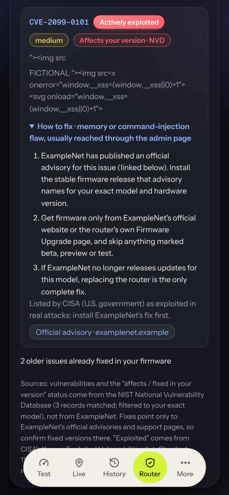 | 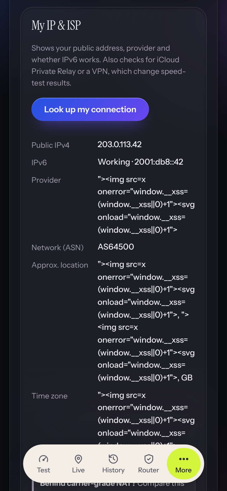 |
| The description shows the injected markup as plain text; the bad severity falls back to "medium"; the `javascript:` and `data:` links were dropped, so only the maker's `https` advisory remains. | Provider, location and time zone carry `` and `<svg onload>` payloads, shown as text. |

Every record in these screens is fictional test data.

## Install, use and self-host

### Use it

Open **https://jsankr.github.io/Speedtest/** in Safari, Chrome, Edge or Firefox.

**Add to Home Screen** for an app-like icon:
- **iPhone/iPad (Safari):** Share → **Add to Home Screen**.
- **Android (Chrome):** ⋮ menu → **Add to Home screen** / **Install app**.
- **Desktop Chrome/Edge:** install icon in the address bar.

### Host your own copy

The whole app is the built `index.html` (React and all styles and fonts inlined), plus `oui.txt` for offline device lookup and `assets/3d/` for the rendered 3D plates (optional: without them the app draws its own).

1. Fork or copy this repository.
2. **Settings → Pages → Deploy from a branch → `main` / root.**
3. To change the app, edit the source in `app/`, run `cd app && npm ci && npm run build` (writes `index.html` at the root) and commit both. CI fails if the two don't match. Pages republishes automatically in about a minute.

Any static host works (Netlify, Cloudflare Pages, nginx, or opening the file directly — offline device lookup needs `oui.txt` beside it and a web server, since browsers block reading local files).

### Claude artifact edition

`cd app && npm run build:artifact` builds a version that runs as a Claude artifact (written to `app/dist-artifact/`, published with its supporting files). Artifacts can only reach files published with the page, so that edition:

- measures **download and latency** against `speedtest.png` (a valid PNG of random noise, which can't be compressed) and `ping.txt` on the artifact host; **upload** and **loaded latency** aren't measured, because there is no second host to probe;
- turns off the features that need outside services (the global test servers, the vulnerability lookup, My IP, DNS benchmark), plus device lookup, whose 1.6 MB registry isn't bundled; each says so and links to the full app;
- shows the CSV export as copyable text, because artifacts block downloads, and uses `#history`-style screen links (`#units` for Settings, a name claude.ai reserves).

### Self-host a test server

`server/server.py` is a test server using only the Python 3.9+ standard library, with no request logging.

```bash
python3 server/server.py --port 8080
```

| Endpoint | Purpose |
|---|---|
| `GET /ping` | 204, no body |
| `GET /down?bytes=N` | N bytes of random data (max 100 MB per request) |
| `POST /up` | Reads and discards the body |
| `GET /` | Serves `../index.html` (the app) |
| `GET /oui.txt` | The MAC maker registry, so Device lookup works offline when self-hosted |
| `GET /assets/3d/*` | The Blender-rendered plates for the collider, GO sphere and dial bezel |

Open `http://<server-ip>:8080/` to run CleanSpeed against it directly — good for testing your LAN or Wi-Fi without the internet in the way. To use it from the GitHub Pages copy instead (**Change server → Your own server**), it must be served over **https** (put Caddy or nginx in front), because browsers block http requests from https pages.

---

## Troubleshooting

| Symptom | Likely cause | What to do |
|---|---|---|
| Speed stuck near **11–12 MB/s (~93 Mbps)** on a faster plan | A cable or port negotiated **100 Mbps** instead of 1 Gbps (loose or damaged cable, 4-wire cable, old switch) | Reseat or replace the cable between the ISP box and router (Cat5e or better); check the router's WAN link speed. |
| Results far below plan on Wi-Fi only | Distance, 2.4 GHz band, interference | Test next to the router on 5 GHz; compare with a cable. |
| Ping much higher than usual, or **lower than the map's physical minimum** | iCloud Private Relay or VPN is routing traffic elsewhere | Turn off Private Relay for this network (Settings → Wi-Fi → ⓘ) and retest. |
| "Upload couldn't be measured" | The server didn't confirm uploads in time (download and ping are still saved) | Change server and retest. |
| Network shows the wrong type | iPhone browsers don't expose it | Pick Wi-Fi / Mobile / Ethernet under GO; change past tests in History. |
| Router check says lookup failed | NVD unreachable or rate-limited | Wait a minute and retry. The settings part still works. |
| Device lookup shows "Unknown maker" | Private (randomised) address, or not in the IEEE registry | Check the device's Wi-Fi settings for "Private address". |
| Test uses lots of mobile data | 10-second phases at high speed | Lower **Seconds per phase** and streams in Settings. |
| CSV opens with odd characters | Very old Excel | Import as UTF-8. |

---

## Limitations

- **A browser can't do everything a native app can:** no traceroute, port scan, Wi-Fi channel scan or signal strength, and no router login. The router check relies on your answers plus public vulnerability data.
- **The map is stylised**, not a geographic map; positions are approximate.
- **Cloudflare's data centre** is located only when the browser can read Cloudflare's `/meta` or `/cdn-cgi/trace` reply; if both are blocked (some content blockers do), the map falls back to pulses around you.
- **The router check** can only be as current and precise as NVD's records. "Can't confirm" means the record lacks version data — check the maker's advisory.
- **Global medians** are third-party compilations of Ookla data with a publication lag.
- **Speeds above a few Gbps** may be limited by the device's browser and CPU rather than the line.
- `ios/` Swift sources from the original concept are not part of this repository; the web app is the maintained version.

---

## Architecture

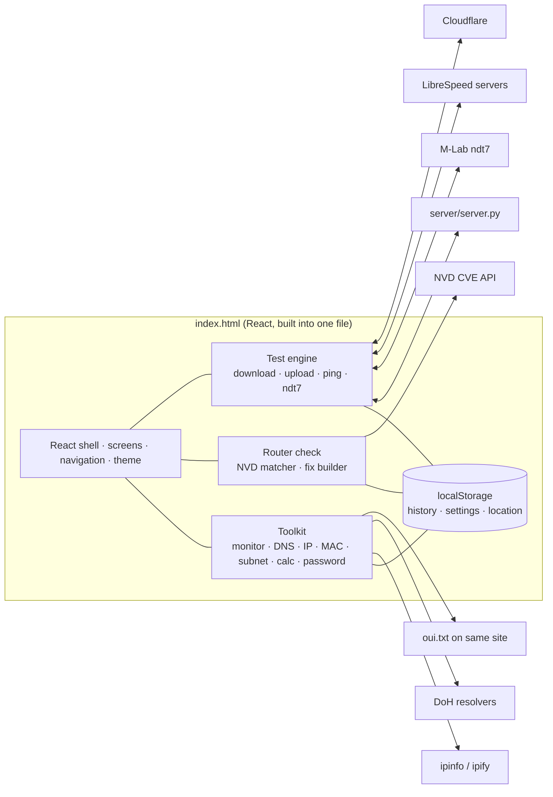

```
.
├── index.html            # the built app (generated by app/, committed so Pages serves it)
├── app/                  # React source (Vite)
│   ├── src/App.jsx       # shell: sidebar, tab bar, routing (#/test, #/live, …), theme, server sheet
│   ├── src/views/        # one component per screen; element ids are the engine's contract
│   ├── src/engine/       # measurement, router check, toolkit, map, collider, help assistant
│   ├── src/styles/       # fonts.css (bundled faces), base.css (components), theme.css (tokens, shell, bento)
│   └── scripts/place.mjs # copies the single-file build to the repository root
├── oui.txt               # IEEE MAC maker registry (offline device lookup)
├── oui-LICENSE.txt       # licence for oui.txt
├── assets/3d/            # Blender-rendered plates (collider teardown frames; the GO sphere and bezel plates are no longer used) + scene.json camera
├── blender/render_plates.py  # builds and renders the 3D scene (Blender 4.2 LTS, Cycles)
├── fonts/                # Instrument Sans, Instrument Serif, Geist Mono (Latin subset, WOFF) + OFL licences
├── DESIGN.md             # design system: tokens, components, motion, accessibility
├── tests/run.py          # end-to-end + WCAG 2.2 AA tests (Chromium, Firefox, WebKit)
├── tests/screens.py      # regenerates docs/screenshots from the build (sample data)
├── .github/workflows/    # CI: tests on every push; render.yml re-renders the 3D plates
├── docs/TEARDOWN.md      # design, usability and accessibility audit
├── server/
│   └── server.py         # optional self-hosted test server
└── docs/screenshots/     # images used in this README (sample data)
```

- React 18 renders the screens; Vite and `vite-plugin-singlefile` inline everything (React, CSS, fonts) into one `index.html`, so the app still deploys and installs as a single file and makes no requests for code. The only runtime dependencies are `react` and `react-dom`.
- React draws each screen's markup once; the engine (`app/src/engine/engine.js`, the proven measurement and tool code) wires behaviour to the same element ids. Every screen stays mounted and is hidden when not in view, so a test keeps running while you look at the map, the collider or your history.
- Charts, gauge and map are drawn with Canvas 2D; the collider's 3D plates are pre-rendered in Blender and live data is overlaid on them.
- Icons and the web-app manifest are embedded as data URIs.
- `app/scripts/place.mjs` adds a Content-Security-Policy to the build that allows only the build's own script (by SHA-256 hash), and writes the same policy to `server/csp.txt` for the self-hosted server's headers.
- Tests cancel cleanly through an `AbortController`; every network request has a timeout.

---

## Design system

The look and behaviour are written down in **[DESIGN.md](DESIGN.md)**, so every change stays consistent.

- **Aurora Bento:** frosted-glass panels over soft blue, pink and mint light on a warm cream ground (deep ink in dark mode), arranged as a bento grid of tiles. Solid colour tiles carry the results: ink for download, coral for upload, sky for latency, lilac for responsiveness, mint for your place in the world.
- **Typography:** Instrument Serif for screen titles and the big result numbers, Instrument Sans for reading text, labels and buttons (sentence case), Geist Mono for live numbers, units and addresses. The fonts are bundled, so the page makes no font requests.
- **One meaning per colour:** blue is always download, coral is always upload; green / yellow / red only for pass / caution / fail, and always with words. The lime sphere is the one primary action (GO / Retest).
- **Navigation:** a glass sidebar on laptops; a floating black tab bar (Test, Live, History, Router, More) on phones and tablets. The current screen is a solid pill. Every screen has its own link (`#/history`), and Back works.
- **Motion with a job:** a short slide when a screen opens, hover lift and press on controls (140–220 ms), live data. Animation loops stop when nothing changes. With *Reduce motion* turned on, transitions are cut and the map starts without animation.
- **Fits every screen:** results first on phones (320 px and up), two-column bento on tablets, three-column bento with sidebar on laptops and desktops.
- **Browsers:** Chrome / Edge 111+, Safari 16.2+ (Mac, iPhone, iPad), Firefox 113+. Browsers without backdrop blur get solid panels.
- **Accessibility (WCAG 2.2 AA):** text contrast at least 4.5:1 in both themes, visible focus outlines, touch targets at least 44 px, no sideways scrolling at 320 px.

## Accessibility

CleanSpeed targets **WCAG 2.2 level AA** and is checked automatically on every push.

- **Keyboard:** every control is reachable with Tab, focus is always visible, and the first Tab stop is *Skip to the speed test*.
- **Screen readers:** landmarks (`header`, `main`, `footer`), labelled charts and map, toggle buttons that announce their state, and a live status line that announces "Testing download…", "Done." and errors.
- **Vision:** text contrast at least 4.5:1 in both themes (including every stop of the button gradients), colour never carries meaning alone, text spacing and 200% text don't break the layout, and Windows high-contrast mode keeps every panel and control outlined.
- **Touch and motion:** targets at least 24 px everywhere and 44 px on touch screens; *Reduce motion* cuts transitions and starts the map without animation.

The latest audit, with every finding and fix, is in **[docs/TEARDOWN.md](docs/TEARDOWN.md)**. Still worth doing by hand before a release: a full pass with VoiceOver and NVDA, and 400% zoom on desktop.

## Testing

```bash
pip install playwright
python -m playwright install chromium firefox webkit
npm install --no-save axe-core@4.10.2          # optional: adds the axe-core WCAG scan
AXE_PATH=node_modules/axe-core/axe.min.js python tests/run.py
python tests/run.py --browser webkit           # one engine (WebKit = Safari's engine)
```

The suite starts `server/server.py` on localhost (it serves the app and acts as the speed-test server) and answers every other request with fictional fixtures, so it never touches the internet or anyone's real data. It covers:

| Area | Checks |
|---|---|
| Security (OWASP Top 10:2025) | CSP present and enforced, hostile vulnerability-database and IP-lookup data rendered as text, only https advisory links, tampered saved data can't inject or crash, hostile typed input, server headers, path traversal, malformed/oversized uploads, idle connections |
| Navigation | Every screen opens from the sidebar or tab bar and shows only itself, Back returns to the previous screen, screen links open directly |
| Speed test | Own server selected, download and upload measured, Stop within 3 s, Retest, history saved, unit switch, CSV export, page and chart height stay sane after a test |
| Router check | Score shown, exploited record flagged, fix links only on the maker's domain, third-party exploit write-ups never linked, no beta firmware, other firmware lines not marked as affecting |
| Toolkit | Subnet (carrier-grade NAT), data calculator, password generator, device lookup from the bundled registry (incl. private and invalid addresses), IP lookup, DNS benchmark |
| Layout | No sideways scroll at 320, 390, 768, 1024 and 1440 px in dark and light themes |
| WCAG 2.2 AA | Contrast (text and gradient stops), names, roles and states, landmarks, skip link, headings, labelled graphics, live status, target size (24 px; 44 px on touch), keyboard reach, visible focus, no trap, reflow at 320 px / 200% text, text spacing, reduced motion, axe-core rules |

Contrast is checked on every screen, every tool and the server sheet. The app's Content-Security-Policy would also block the harness's own helpers (Playwright polling, axe-core), so the harness serves its pages with the policy removed; the security suite loads the real page separately to prove the browser enforces it. `python tests/screens.py` regenerates the README screenshots from the build.

GitHub Actions builds the React app, checks the committed `index.html` matches the source, then runs the whole suite in **Chromium, Firefox and WebKit** on every push ([`.github/workflows/tests.yml`](.github/workflows/tests.yml)).

## Data sources and licences

| Data | Source | Use |
|---|---|---|
| Country and world speed medians | Ookla Speedtest Global Index (compiled by bizolaunch.com) | Global comparison, world ruler |
| Vulnerabilities | U.S. National Vulnerability Database, CVE API 2.0 | Router check |
| Exploited vulnerabilities | CISA Known Exploited Vulnerabilities catalogue (via NVD) | "Actively exploited" badge |
| MAC makers | IEEE registry via oui-data by silverwind, BSD-2-Clause (see `oui-LICENSE.txt`) | Device lookup |
| Volunteer servers | LibreSpeed | Server list |
| Typefaces | Instrument Sans and Instrument Serif (Instrument), Geist Mono (Vercel), via the Google Fonts repository; SIL Open Font License 1.1 (see `fonts/`) | All text |
| Streaming/call requirements | Netflix and Zoom published requirements | Readiness tiles |

CleanSpeed is not affiliated with Ookla, Speedtest®, Cloudflare, M-Lab, LibreSpeed or any router maker. Product names are their owners' trademarks.

---

## Changelog

| Commit | Change |
|---|---|
| *latest* | **Security:** OWASP Top 10:2025 assessment (report above); fixed XSS from vulnerability-database fields, `javascript:` advisory links, crash on tampered saved data, server robustness (400/413, idle timeout), missing CSP and headers; build tools upgraded (0 advisories), Actions pinned, Blender checksum; 23-check security suite in CI |
| `f35f7a6` | **CleanSpeed 2:** rebuilt in React (Vite, single-file build) with the "Aurora Bento" design: sidebar and floating tab bar, one screen per area with its own link, bento result tiles, gradient ring gauge, lime GO sphere, light/dark/auto theme switch, results-first phone layout; every module kept; tests updated for screen navigation and run on every screen; screenshots regenerated |
| `d6b89e7` | Help assistant: on-device knowledge base (about 40 entries with sources), retrieval, one-press diagnosis of the last test, no network; tests and screenshot added |
| `da345f9` | Real 3D rendering with Blender: the collider (9 teardown frames), GO sphere (light and dark) and dial bezel are path-traced in Cycles on GitHub Actions; live packets, tracks and labels are overlaid through the Blender camera; collision tracks spray in 3D; teardown labels never overlap |
| `e0e1858` | Collider rebuilt on the real CMS/LHC structure: cutaway 12-sided detector (tracker, ECAL, HCAL, solenoid, iron yoke and muon chambers) on a ring of dipole magnets; colliding bunches; CMS-style opening teardown; detector drawn once and cached |
| `f5985d7` | Packet collider: 3D view of ping, download and upload driven by the real byte counters, with a teardown of the result; tests and screenshots updated |
| `f2c01ce` | Teardown and testing: WCAG 2.2 AA fixes (skip link, main landmark, ARIA roles, labelled charts, live status, gradient contrast, target sizes, forced colours); design fixes (no accent-word headings, sentence-case labels, mono only for numbers); Safari chart-height bug fixed; automated tests in Chromium, Firefox and WebKit on every push; [docs/TEARDOWN.md](docs/TEARDOWN.md) |
| `3cd2379` | Typography: Instrument Serif titles with italic accents, Instrument Sans text, Geist Mono numbers and labels; fonts bundled (no Google Fonts request); canvases redraw when fonts load |
| `c56eb8d` | Glass instrument redesign: frosted-glass panels over still light fields, engraved wells, 3D GO sphere, glass dial with bead, colour-coded 3D tool chips, raised segmented controls, one entrance on load and hover lift; chart fills the readout column on wide screens; layouts checked at 320–1440 px; Safari prefixes and solid fallback; glass app icon |
| `d284597` | Redesign: instrument-panel design system ([DESIGN.md](DESIGN.md)); flat dial gauge; cyan download / amber upload; one button family; no glows, pulses or tilt; gauge stops redrawing when idle; reduced-motion support; 44 px touch targets; contrast checked in both themes; new app icon |
| `200e531` | Live map: dots driven by real bytes and measured delay, live ping after a test, Cloudflare data-centre lookup, zoom to fit short routes, labels never cover markers or the route |
| `e427d4e` | Detailed README with fictional sample screenshots (router, CVEs, speeds, history, MACs, IPs); self-host test server; map labels no longer overlap when you and the server are close; records covering only another firmware line count as "fixed in your version" |
| `f7f4ce8` | Device lookup: on-device IEEE maker registry (no third-party lookup) |
| `c4a10ea` | Router check: manufacturer-only fixes, firmware-line-aware matching |
| `6cb9e46` | Fix tests stuck at upload; add Stop and RETEST |
| `aa314a4` | Live network map, telemetry, 10-tool toolkit, router security fixes |
| `8348463` | CSV export fixed |
